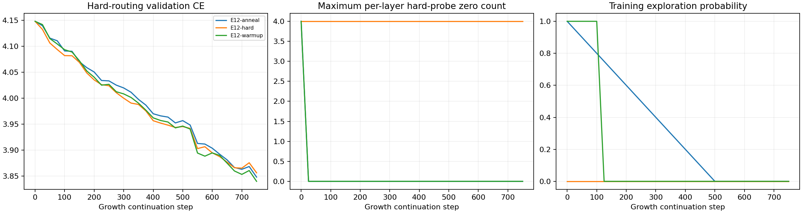

# Clone routing lab outcomes

All validation and calibration probes use HARD routing, even when training is stochastic. CPU smoke results on toy tokens only verify execution; they do not answer the language-training question.

| Arm | Status | Total params | Switch | Post-switch steps | Final hard-probe zero count |
|---|---|---:|---:|---:|---|
| E12-hard | completed | 12,030,336 | 0 | 750 | [4, 4, 4, 4] |
| E12-warmup | completed | 12,030,336 | 125 | 625 | [0, 0, 0, 0] |
| E12-anneal | completed | 12,030,336 | 500 | 250 | [0, 0, 0, 0] |

A zero expert count on one batch is not permanent death. The training-window metric aggregates the last configured number of steps; the hard-probe metric aggregates recent fixed calibration probes. Neither guarantees future survival. Output distances are sampled within clone families and are diagnostics, not a validated switching threshold.

Estimated memory skips, CUDA OOM, runtime failures and time limits are different outcomes. No GPU result should be inferred from the local smoke run.

