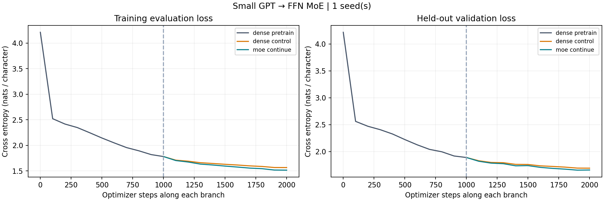

# Small GPT → MoE results

| Seed | Initial validation | Trained dense GPT | Continued dense | Continued MoE | MoE test |
|---|---:|---:|---:|---:|---:|
| 17 | 4.216622 | 1.889442 | 1.691272 | 1.657208 | 1.876497 |

Dense: **682,368** parameters; MoE: **1,864,064** total, **1,077,632** under the documented active-parameter convention.

Architecture: 4 causal Transformer layers, width 128, 4 heads, context 128, SwiGLU FFNs, tied token/output weights and learned positions. Four experts per FFN, top-2 normalized routing, dropless dispatch. No dropout or autocast in this baseline.

Maximum conversion logit error across seeds: 3.33786011e-05.

Acceptance per seed:

- Seed 17: {"dense_train_drops": true, "dense_validation_drops": true, "moe_train_drops": true, "moe_validation_drops": true, "all_expert_matrices_updated": true, "conversion_preserved": true}

## Interpretation

This is the clarified GPT routing. Dense and MoE losses are measured at every next-character position using causal attention. Every expert matrix updated. Saved models, optimizer and sampler states reproduced the next update within 1e-6. No semantic expert specialization is established.

Both continuation branches reset AdamW, use the same lower learning rate and identical sampled sequence order. Expert routing alone changes the FFN path; attention, embeddings, norms and output head are copied. Task CE is separate from the mean layer-balancing term. The reported timing includes evaluation and excludes saving/reload checks. There is no learning-rate sweep or best-checkpoint selection.

Validation/test use fixed sampled windows from an 80/10/10 raw-text split. Windows cannot cross split boundaries, but windows within a split may overlap. This short-context character model is a mechanism experiment. Its character CE cannot be compared directly to subword-token CE or to the original single-target linear task.

This is a one-seed CPU pilot, not a multi-seed quality comparison or GPU benchmark.

Top-2 routing increases active FFN work relative to dense; neither total parameters nor FLOPs are matched. Any small loss difference needs repeated seeds and fair compute controls before interpretation.

