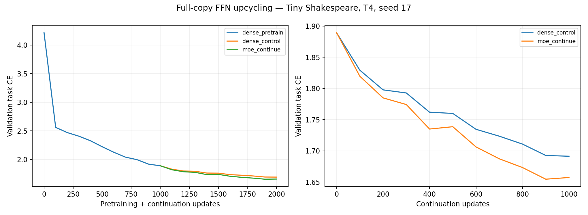
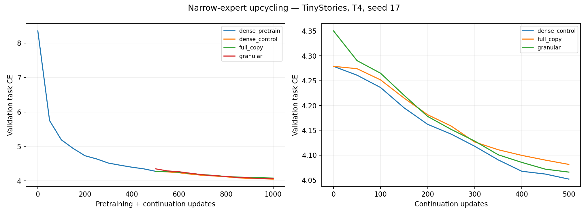
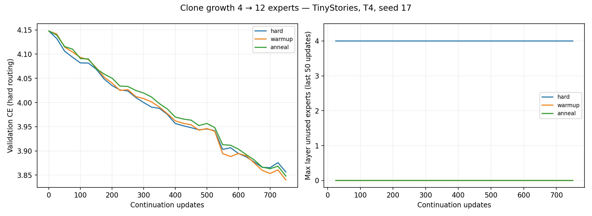
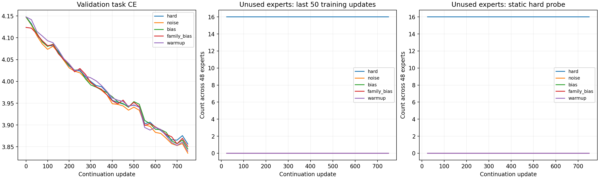
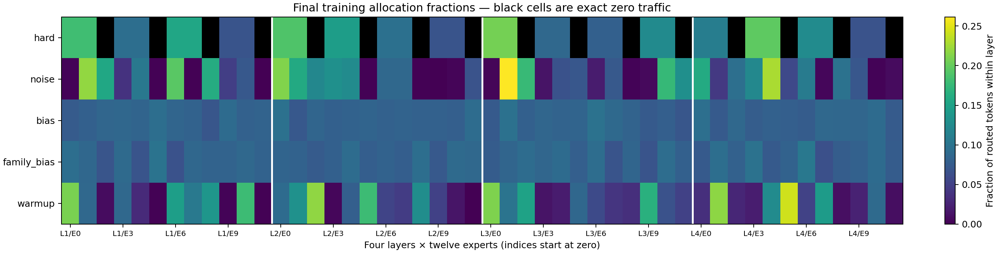

# Dense GPT → Sparse Mixture of Experts

We started with a simple linear-model routing test on CPU, then moved to small dense GPTs and completed GPU experiments on a Tesla T4. Copying trained feed-forward blocks into full-size experts preserved the starting model’s predictions and allowed further learning; the character-level MoE finished ahead of its dense continuation control.

Splitting those blocks into smaller experts initially worsened loss. Continued training recovered that loss, but the dense control still finished slightly better and faster.

We then grew a trained MoE from four to twelve experts per layer by cloning. Immediate hard routing reduced loss but left 16 of 48 experts completely untrained. Sampled warmup and gradual switching to hard routing fixed this. Later, a small one-time router perturbation and balancing biases also gave every expert training exposure and task gradients. Perturbation achieved the lowest final loss; bias balancing gave the most even expert use. These are small, single-seed results, not a general guarantee that MoE wins.

**Completed experimental study · Google Colab Tesla T4 · seed 17 · 13 October 2026**

| Completed T4 experiment | Conversion/start validation CE | Final validation CE | Final test CE | Main finding |
| --- | --- | --- | --- | --- |
| Character GPT → 4 full-size experts/top-2 | 1.889442 | 1.657208 | 1.876497 | Continued learning; dense control ends at 1.691272 |
| TinyStories → 16 narrow experts/top-4 | 4.350333 | 4.065797 | 4.061487 | Recovered conversion increase; dense control ends at 4.051691 |
| TinyStories clone growth: immediate hard top-2 | 4.147820 | 3.856335 | 3.880374 | 4/12 experts per layer never receive tokens |
| Same clone growth: 125-update sampled warmup | 4.147820 | 3.839930 | 3.866121 | All experts used; 625 hard updates after switch |
| Same clone growth: anneal over 500 updates | 4.147820 | 3.848049 | 3.865996 | All experts used; 250 hard updates after switch |
| Follow-up: noise | 4.147373 | 3.835305 | 3.859548 | 0/48 lifetime, window and static-probe dead experts |
| Follow-up: bias | 4.147820 | 3.845077 | 3.862233 | 0/48 lifetime, window and static-probe dead experts |
| Follow-up: family_bias | 4.123746 | 3.850813 | 3.866495 | 0/48 lifetime, window and static-probe dead experts |

**Interpretation:** all MoE branches reduced loss. Full-copy character MoE beat its dense continuation control in this run. Narrow TinyStories MoE recovered its conversion loss, but dense continuation finished slightly better and faster. Sampling improved utilization after cloning without preventing subsequent hard-routing training. Character and subword CE are different units; compare branches only within the same experiment. These are controlled single-seed findings, not a statistical claim that MoE always wins.

| Model | Residual / expert width | Experts / top-k | Total parameters | Selected-parameter convention |
| --- | --- | --- | --- | --- |
| Character dense GPT | 128 / 256 | 1 / 1 | 682,368 | 682,368 |
| Character full-copy MoE | 128 / 256 | 4 / 2 | 1,864,064 | 1,077,632 |
| TinyStories dense GPT | 192 / 384 | 1 / 1 | 2,289,024 | 2,289,024 |
| TinyStories full-copy control | 192 / 384 | 4 / 1 | 4,946,304 | 2,292,096 |
| TinyStories narrow MoE | 192 / 96 | 16 / 4 | 4,955,520 | 2,301,312 |
| TinyStories parent MoE | 192 / 384 | 4 / 2 | 4,946,304 | 3,176,832 |
| TinyStories grown MoE | 192 / 384 | 12 / 2 | 12,030,336 | 3,182,976 |

The selected-parameter convention counts all nonexpert weights, including the full tied embedding table, plus selected expert weights. It is **not** a FLOP count, a count of touched embedding rows, or a resident-memory reduction.

## Submission package and provenance

This repository consolidates the completed training study, `routing_followup/`, and `development_archive/`. Current Colab entry points are `notebooks/GPT_to_MoE.ipynb`, `notebooks/Narrow_Experts_T4.ipynb`, `notebooks/Clone_Collapse_T4.ipynb`, and `routing_followup/notebooks/Hard_Routing_Expert_Learning_T4.ipynb`. Earlier notebook versions and CPU/failed-run evidence remain under `development_archive/` for context.

Checkpoints are excluded from this submission and remain in the original external backup. Statements about checkpoint audits describe the completed original review; they do not imply checkpoint files are bundled here. No new GPU training was performed during consolidation.

The submission snapshots have been sanitized for portable presentation, including legacy identifier names. `provenance/source_verification.json` separates original source digests from submission digests. Historical mismatches are explicitly recorded. `provenance/file_manifest.json` accounts for copied, excluded, and deduplicated files; exact original relative paths are encoded as UTF-8 base64. `provenance/deduplication.json` records relative links to canonical copies. These links resolve inside the repository; preserve them when copying or use archive tooling that dereferences links. Treat shared historical content as immutable; detach a runnable link before editing its source.

`python3 scripts/audit_colab_evidence.py` verifies the submission snapshots and regenerates the original-study figures. `python3 -m scripts.audit_routing_followup` verifies follow-up metadata and regenerates figures without checkpoint access. To repeat the full checkpoint audit, add `--checkpoint-root` with the external original training directory. The report distinguishes metadata verification from checkpoint verification.

For the separate follow-up suite, run `cd routing_followup` and `python3 -m unittest discover -s tests -v`. Its standalone notebook embeds the required source; the pinned parent checkpoint must be supplied from the backup for reproduction. Study materials are kept beside this repository.

## 1. Evidence and experimental design

Four completed Colab evidence packages contain configurations, source snapshots, metrics, final summaries, figures and externally retained checkpoints:

| Study | Completed run | Primary evidence |
|---|---|---|
| Full-copy character GPT | `gpt-colab-recovered-20261012-180346-953876` | [Summary](MoE_Training-results/results/gpt-colab-recovered-20261012-180346-953876/summary.json), [step records](MoE_Training-results/results/gpt-colab-recovered-20261012-180346-953876/metrics.jsonl), [environment](MoE_Training-results/results/gpt-colab-recovered-20261012-180346-953876/environment.json) |
| Narrow experts on TinyStories | `granular-20261012-122635-419439` | [Summary](MoE_Granular_Lab-evidence/results/granular-20261012-122635-419439/summary.json), [step records](MoE_Granular_Lab-evidence/results/granular-20261012-122635-419439/metrics.jsonl), [environment](MoE_Granular_Lab-evidence/results/granular-20261012-122635-419439/environment.json) |
| Clone routing on TinyStories | `clone-first-20261012-133612` | [Summary](MoE_Clone_Lab-evidence/results/clone-first-20261012-133612/summary.json), [base stages](MoE_Clone_Lab-evidence/results/clone-first-20261012-133612/base_summary.json), [step records](MoE_Clone_Lab-evidence/results/clone-first-20261012-133612/metrics.jsonl) |
| Hard-routing repair and expert learning | `hard-routing-20261013-041132-668911` | [Summary](MoE_Routing_Followup-20261013-041132-668911/results/hard-routing-20261013-041132-668911/summary.json), [step records](MoE_Routing_Followup-20261013-041132-668911/results/hard-routing-20261013-041132-668911/metrics.jsonl), [environment](MoE_Routing_Followup-20261013-041132-668911/results/hard-routing-20261013-041132-668911/environment.json) |

The actual environment in all four packages is **Python 3.13.15, PyTorch 2.11.0+cu130, CUDA execution, Tesla T4**, with FP32 training and no dropout/autocast. The hardware class is a T4 with 16 GB VRAM; checkpoint/environment metadata confirms the GPU model, while the tables below report actual PyTorch allocated memory. Training was performed in the uploaded Colab sessions. Local work reviewed and loaded their evidence; it did not rerun the GPU jobs.

All **21 original recorded source SHA-256 entries** were verified against the external original packages; sanitized submission digests are tracked separately: five character-study files, six narrow-study files, six original clone-study files and four follow-up files. Tokenizer hashes match their manifests. Every listed continuation reached its configured final update; all three original clone outcomes are `completed`, and all five follow-up policies reached update 750. The follow-up parent and packed-data checksums match the original clone experiment. The source/config snapshots in the evidence packages define the executed experiment even when current runnable notebooks contain later engineering fixes. Older generated report boilerplate incorrectly calls some runs CPU runs; the environment records and checkpoints establish CUDA/T4 execution.

Audit artifacts: [evidence/source audit](analysis/evidence_audit.json), [optimizer/checkpoint audit](analysis/checkpoint_audit.json), [clone parameter audit](analysis/clone_parameter_audit.json), and [follow-up learning audit](analysis/routing_followup_audit.json). The audit script regenerates figures from raw records without retraining.

### Budgets and controls

| Study | Dense updates | Parent-MoE updates | Continuation updates per arm | Batch × context | Target tokens per continuation | Cumulative targets per final model path |
|---|---|---|---|---|---|---|
| Character full-copy | 1,000 | — | 1,000 | 16 × 128 | 2,048,000 | 4,096,000 |
| TinyStories narrow | 500 | — | 500 | 4 × 128 | 256,000 | 512,000 |
| TinyStories clones | 500 | 250 | 750 | 4 × 128 | 384,000 | 768,000 |
| Hard-routing follow-up | Reused | Reused | 750 | 4 × 128 | 384,000 | 768,000 |

A supervised target is one shifted next-token prediction, not one sequence or all context reads. GPT targets cover every position. Budgets above count the shared pretraining once per final model path; separate experimental branches add additional executed work. There is no gradient accumulation, hidden extra training, early stopping or best-checkpoint selection. Reports use the final configured checkpoint.

Dense/full-copy/narrow branches within a study start from the same trained dense checkpoint and use identical continuation batches. Clone arms all start from the same trained four-expert parent and use identical continuation batches. They are independent branches, not a sequential chain in which one policy inherits another’s updates. The TinyStories narrow and clone runners use different pretraining sampler seeds, so their dense checkpoints are not interchangeable even though architecture, corpus and initialization seed match.

## 2. Data, tokenizer and evaluation

### Tiny Shakespeare: character experiment

The corpus is 1,115,394 bytes/characters and has 65 training-derived character IDs. Its SHA-256 is:

```text
86c4e6aa9db7c042ec79f339dcb96d42b0075e16b8fc2e86bf0ca57e2dc565ed
```

The contiguous raw-text split is 892,315 training, 111,539 validation and 111,540 test characters. Splitting occurs **before** forming windows, preventing boundary leakage. A context has 128 input characters; the target sequence is shifted by one character. The vocabulary is learned from training text. Fixed evaluation sampling uses 64 sequences/split, or 8,192 target characters, and may sample overlapping windows with replacement. Evaluation is chunked into eight sequences to bound temporary memory. Train/validation probes occur every 100 updates; held-out test CE is measured at final branch checkpoints.

[Exact corpus/split manifest](MoE_Training-results/results/gpt-colab-recovered-20261012-180346-953876/data_manifest.json) · [Download provenance](data_specs/tinyshakespeare.json)

### TinyStories: both subword experiments

Both packages independently recorded the **same manifest and tokenizer checksum**:

| Property | Value |
|---|---|
| Dataset | `roneneldan/TinyStories` |
| Dataset revision | `f54c09fd23315a6f9c86f9dc80f725de7d8f9c64` |
| Training stories | 12,000 |
| Validation / test stories | 1,200 / 1,200 |
| Training tokens | 2,690,332 |
| Validation / test tokens | 250,020 / 250,173 |
| Tokenizer | Byte-level BPE, trained on training stories only |
| Actual vocabulary | 4,096, including `[UNK]` and `[EOS]` |
| Shuffle | Seed 17, streaming buffer 2,000 |
| Tokenizer SHA-256 | `deb6208dc72ae00908b6449c0c24d06a875452552381e83cfce141f6d0623093` |

The official validation split supplies separate validation/test subsets. Exact cross-split document hashes remove overlaps; this is not near-duplicate decontamination. Training-document internal deduplication is not claimed. Buffered streaming shuffle is reproducible for the pinned revision, but is not globally uniform sampling of the entire dataset.

Documents are concatenated with EOS; causal attention **can cross EOS**. Sampled sequences have 128 inputs and 128 next-token targets. Both experiments use 32 fixed evaluation sequences/split, 4,096 target tokens. The narrow experiment evaluates every 50 updates. The clone experiment evaluates every 25 updates and also uses a fixed **training-only** calibration probe of 64 sequences, 8,192 tokens, for routing coverage. No test-set routing calibration or parameter selection is used.

The clone packed-array checksum is `ffe76e4ff906b4bf2be7d0abd5ce61dd74eb497d78a2d37e614f8ad153e164bc`; the narrow run’s packed-array checksum is recorded in its data manifest. The evidence archives contain manifests/tokenizers, while packed arrays can be regenerated with the included preparation script.

[Shared audited data record](analysis/evidence_audit.json) · [Narrow data manifest](MoE_Granular_Lab-evidence/results/granular-20261012-122635-419439/data_manifest.json)

Cross-entropy is reported in nats per predicted token. The optimized objective includes a separate routing term where specified; tables show **task CE**. Character CE and BPE CE must not be compared as if they used the same vocabulary or target distribution.

## 3. Architecture, shapes and parameter accounting

### Decoder architecture

All models use four decoder-only Transformer blocks with pre-LayerNorm residual paths:

```text
x = token_embedding(ids) + position_embedding(positions)
x = x + attention(LayerNorm(x))
x = x + FFN_or_MoE(LayerNorm(x))     # repeated for four blocks
logits = tied_output_projection(final_LayerNorm(x))
```

Attention is causal scaled-dot-product attention; positions are learned. The output head and token embedding reference the **same parameter**, so the vocabulary matrix is counted once. LayerNorm has scale and bias. QKV, attention output, SwiGLU matrices and routers are bias-free. There are no shared always-on experts in these runs. Attention, embeddings, norms and positions are retained across FFN conversion and continue training jointly.

Weights initialize from `Normal(0, 0.02)`. Attention output and dense FFN down matrices use `0.02/sqrt(2L)` with `L=4`. Newly introduced routers initialize at standard deviation 0.02 for full/narrow conversion. Clone routers copy trained parent rows exactly; no router noise was added in the clone comparison.

### Tensor shapes

`B` is microbatch size, `T=128`, `d` is residual width, `h` is expert intermediate width, `E` is stored experts, `k` is selected experts, and `N=B*T`.

| Tensor / parameter | General shape | Character experiment | TinyStories experiment |
|---|---|---|---|
| Input / target IDs | `[B,T]` | `[16,128]` | `[4,128]` |
| Token embedding / tied head weight | `[V,d]` | `[65,128]` | `[4096,192]` |
| Learned position weight | `[T,d]` | `[128,128]` | `[128,192]` |
| Hidden activations | `[B,T,d]` | `[16,128,128]` | `[4,128,192]` |
| QKV weight | `[3d,d]` | `[384,128]` | `[576,192]` |
| Q, K, V after head reshape | `[B,H,T,d/H]` | `[16,4,128,32]` | `[4,6,128,32]` |
| Attention output weight | `[d,d]` | `[128,128]` | `[192,192]` |
| Dense/full-expert gate and up weights | `[h,d]` | `[256,128]` | `[384,192]` |
| Dense/full-expert down weight | `[d,h]` | `[128,256]` | `[192,384]` |
| Narrow gate / up; down | `[h,d]`; `[d,h]` | — | `[96,192]`; `[192,96]` |
| Flattened router input | `[N,d]` | `[2048,128]` | `[512,192]` |
| Router weight | `[E,d]` | `[4,128]` | Full `[4,192]`; narrow `[16,192]`; grown `[12,192]` |
| Router logits | `[N,E]` | `[2048,4]` | Full `[512,4]`; narrow `[512,16]`; grown `[512,12]` |
| Selected expert IDs / weights | `[N,k]` | `[2048,2]` | Full `[512,1]`; narrow `[512,4]`; grown `[512,2]` |
| Final logits | `[B,T,V]` | `[16,128,65]` | `[4,128,4096]` |

A bias-free SwiGLU has three matrices and computes:

```text
FFN(x) = W_down (silu(W_gate x) ⊙ (W_up x))
```

PyTorch stores Linear weights as `[out_features,in_features]`; confusing rows and columns during partitioning breaks the transferred function. The router sees the normalized FFN input, not raw token IDs. Output dimension always remains `d`, allowing the original residual addition to remain valid.

### Counts and active work

One expert has `3dh` parameters. Each attention block has `4d²` attention weights. Two LayerNorms add `4d` parameters/block; final LayerNorm adds `2d`. Therefore:

```text
P_dense = Vd + Td + L(4d² + 3dh + 4d) + 2d
P_MoE   = Vd + Td + L(4d² + E*3dh_expert + E*d + 4d) + 2d
```

For the character GPT, one full expert has 98,304 weights. For TinyStories, a full expert has 221,184 weights and a narrow expert has 55,296. Four full experts and sixteen quarter-width experts store the same FFN matrix count; the narrow router is larger. Selected work is distinct from stored capacity:

| Branch | Selected intermediate units `k*h` | FFN matrix MACs/token/layer `3dkh` | Router matrix MACs/token/layer `dE` |
|---|---|---|---|
| Character dense | 256 | 98,304 | 0 |
| Character full-copy/top-2 | 512 | 196,608 | 512 |
| TinyStories dense | 384 | 221,184 | 0 |
| TinyStories full-copy/top-1 | 384 | 221,184 | 768 |
| TinyStories narrow/top-4 | 384 | 221,184 | 3,072 |
| TinyStories parent/top-2 | 768 | 442,368 | 768 |
| TinyStories grown/top-2 | 768 | 442,368 | 2,304 |

MACs above exclude attention, activation functions, normalization, selection, dispatch, scattering and backward/optimizer work. A MAC is not automatically one FLOP. The character MoE uses twice the dense selected FFN width, so its loss comparison is token-matched, not compute-matched. Narrow/full-copy TinyStories are matched in FFN matrix MACs but not total runtime. The entire bank stays resident even when only a subset executes.

## 4. Experiment A: full-copy character GPT continuation

| Stage | Train CE | Validation CE | Test CE | Updates / path targets |
| --- | --- | --- | --- | --- |
| Initial dense | 4.209708 | 4.216622 | — | 0 / 0 |
| Dense checkpoint | 1.781824 | 1.889442 | — | 1,000 / 2,048,000 |
| dense_control | 1.566673 | 1.691272 | 1.899665 | 2,000 / 4,096,000 |
| moe_continue | 1.516050 | 1.657208 | 1.876497 | 2,000 / 4,096,000 |

Dense pretraining lowered validation CE from **4.216622 to 1.889442**. After copying each FFN into four full-size experts, MoE continuation reached **1.657208**, below dense continuation’s **1.691272** by **0.034064**. Test CE was **1.876497 versus 1.899665**. Both continuation branches saw identical additional batches and used LR 0.0003, versus 0.0006 during pretraining.

The normalized selected-expert mixture is:

```text
z = W_router x
I = topk(z, k)
a = softmax(z[I])
y = sum(a_j * expert_j(x), j in I)
```

Each expert initially implements the same trained function. Since selected weights sum to one, the mixture equals that function mathematically. Expert copies are checked for exact parameter equality. Sparse dispatch evaluates only the token rows selected for each expert, then accumulates them using `index_add`; it does not compute every expert and mask afterward. Separate token routing subsequently produces different updates.

### Conversion validation and resolved numerical error

On T4, the original absolute-only `1e-5` assertion failed. A relative-plus-absolute check still rejected six entries even though predictions were effectively unchanged. The final successful run retained those diagnostics and passed an independent CPU FP64 check:

| Diagnostic | Recorded value |
|---|---|
| Maximum FP32 logit error | `3.337860107421875e-5` |
| RMS FP32 logit error | `1.225876076205168e-6` |
| FP32 entries outside `1e-5 + 1e-5*abs(reference)` | 6 |
| Maximum probability difference | `3.516674041748047e-6` |
| Dense / MoE probe CE | `1.8894422054290771` / same |
| Probe CE change | 0 |
| FP64 CPU maximum logit error | `3.4638958368304884e-14` |
| FP64 CPU probe CE change | 0 |
| Accepted method | `fp64_reference_and_bounded_fp32` |

The reference uses eight evenly spaced validation sequences, indices `[0,9,18,27,36,45,54,63]`, and FP64 **including router arithmetic**. Require per-entry atol=rtol=1e-10 and CE difference ≤1e-10. When the original FP32 per-entry test fails, require this independent reference **and** finite FP32 outputs with max absolute logit error ≤1e-4, RMS ≤1e-5, maximum probability error ≤1e-5 and absolute CE difference ≤1e-5. The changed acceptance method is explicit; the old per-entry failure was not relabeled as a pass. [Recorded conversion diagnostics](MoE_Training-results/results/gpt-colab-recovered-20261012-180346-953876/conversion-17.json)

Mathematically identical batched/sliced floating-point computations need not be bitwise identical. The independent high-precision result distinguishes copied-function preservation from GPU kernel roundoff; it does not excuse large behavioral changes. [PyTorch numerical accuracy documentation](https://docs.pytorch.org/docs/main/notes/numerical_accuracy.html)

### Utilization after continuation

| Layer | Character top-2 final allocation fractions | Load CV | Router entropy (nats) |
| --- | --- | --- | --- |
| 1 | 0.5000, 0.2797, 0.0717, 0.1486 | 0.6495 | 0.8983 |
| 2 | 0.2333, 0.3118, 0.2291, 0.2257 | 0.1432 | 1.3222 |
| 3 | 0.2773, 0.2687, 0.2138, 0.2402 | 0.1000 | 1.2560 |
| 4 | 0.2755, 0.2355, 0.2299, 0.2592 | 0.0735 | 1.1609 |

All 48 expert FFN matrices changed; matrix L2 changes ranged from **0.704240 to 2.232610**. The first layer is notably imbalanced despite no zero expert on the final probe; a 0.5 fraction under top-2 means that expert is selected for every token, since fractions normalize by **two routes per token**. Utilization therefore means use, not equal load or proven semantic specialization.



## 5. Experiment B: narrower experts on TinyStories

Dense validation CE fell **8.353982→4.278877** over 500 updates. Three branches then continued for 500 updates from the same dense checkpoint.

| Branch | Conversion CE | Final train CE | Final validation CE | Test CE | Conversion CE increase |
| --- | --- | --- | --- | --- | --- |
| dense_control | 4.278877 | 4.064073 | 4.051691 | 4.046532 | +0.000000000 |
| full_copy | 4.278877 | 4.098199 | 4.081297 | 4.078894 | +0.000000119 |
| granular | 4.350333 | 4.076161 | 4.065797 | 4.061487 | +0.071455956 |

### How different FFN sizes were copied

The dense FFN has 384 intermediate units; every narrow expert has 96. Split indices into four contiguous groups, each replicated four times:

```python
idx = torch.arange(partition * 96, (partition + 1) * 96)
expert.gate.weight.copy_(dense.gate.weight[idx, :])  # [96,192]
expert.up.weight.copy_(dense.up.weight[idx, :])      # [96,192]
expert.down.weight.copy_(dense.down.weight[:, idx]) # [192,96]
```

Gate/up rows and down columns must select the **same units**. Experts retain input/output width 192. These are trained parameter subsets, not compressed approximations of the entire dense function. For the bias-free FFN, summing one of each partition reconstructs the dense output.

Our router normalizes top-4 weights, so the narrow mixture is multiplied by the partition count **4**. With uniform weights over one of each disjoint partition, this reproduces the sum. Flat top-4 can omit partitions or select replicas of the same partition; learned unequal gates also change the sum. The resulting **0.071456 CE increase** is measured and expected, rather than incorrectly asserted to be exact function preservation. The maximum narrow conversion logit change was **5.261149**; subsequent loss recovery is the relevant continuation result.

Full-copy top-1 has a normalized selected gate of exactly one. Its task loss cannot train router scores through that gate; discrete selection is not differentiated. Its balancing auxiliary provides router gradients. Top-4 narrow mixtures have nontrivial differentiable gate weights once selected experts differ. Full-copy and narrow experts both use balance coefficient 0.01.

### Result and tradeoff

Narrow conversion CE **4.350333** declined to **4.065797**, below the dense checkpoint’s **4.278877**. All 192 narrow FFN matrices changed; all 224 model parameters acquired Adam state. This demonstrates recovery and continued learning. It did **not** outperform dense continuation’s **4.051691**: the narrow final gap is **+0.014106** validation CE. It did outperform the full-copy control’s **4.081297** by **0.015500** in this seed. Test CE was 4.061487 narrow, 4.046532 dense, and 4.078894 full-copy.

| Layer | Full-copy top-1 load CV | Narrow top-4 load CV | Minimum narrow allocation fraction |
| --- | --- | --- | --- |
| 1 | 0.0984 | 0.5239 | 0.002563 |
| 2 | 0.0413 | 0.3459 | 0.006409 |
| 3 | 0.1106 | 0.3064 | 0.030701 |
| 4 | 0.0168 | 0.4401 | 0.030212 |

No narrow expert had zero allocations on the final fixed validation probe, but the smallest fraction was only 0.002563 in layer one. Narrow experts were more imbalanced than the full-copy top-1 bank at this checkpoint. There is no claim that a nonzero allocation proves useful specialization.

The dense control’s recorded maximum logit drift was 9.536743e-6 even though no architectural conversion occurred: this trainer compares a CPU-held source probe with a CUDA branch probe. Its CE increase was zero. Full-copy drift was also 9.536743e-6, with CE change 1.192093e-7. This is distinct from the material partition-routing change.



## 6. Experiment C: cloning four experts into twelve

The base architecture matches the TinyStories study, with four full-size experts/top-2 in the parent stage. Its validation CE progressed:

```text
Initial dense: 8.353982 → trained dense: 4.288695 → trained parent MoE: 4.123746
```

After the 250-update parent stage, each parent expert and router row was copied **three times**. Four parents became twelve stored experts, retaining top-2. Expert `j` has parent `floor(j/3)`. Copying router rows gives equal initial logits within each family; copying expert weights gives equal family functions. Router noise is zero.

Flat top-2 growth is **not** automatically function-preserving once parents differ. Two siblings from one high-scoring parent can occupy both slots, excluding the second parent previously selected. The grown calibration logit difference was **5.675947**, and growth validation CE rose from **4.123746 to 4.147820**. All routing arms start from this same grown checkpoint.

### Routing schedules actually compared

| Policy | Training exploration probability `p(i)` | Stochastic updates / hard updates | Balancing auxiliary after growth |
|---|---|---|---|
| Hard | 0 throughout | 0 / 750 | 0 |
| Warmup | 1 for updates 0–124, then 0 | 125 / 625 | 0 |
| Anneal | `max(0,1-i/500)` | Mixed during first 500 / final 250 hard | 0 |

Sampled routing uses **Gumbel top-k without replacement**, temperature 1. It selects `topk(z + GumbelNoise)`, while mixing weights use softmax of the original, selected router logits. The random discrete selection is not differentiated. Exploration is chosen per token; it is sparse execution, not a dense soft mixture over all twelve experts. Every layer has its own routing generator, seeded 117; equal seeds give aligned random streams, while differing layer logits still affect selections. All arms use sampler seed 217 and grow-initialization seed 19. Base dense sampling uses seed 17; parent sampling uses seed 18.

All validation/calibration/test probes use **hard routing**, even while training samples. They do not advance the exploration generator or update a routing bias. This avoids mistaking stochastic evaluation coverage for successful hard-routing survival.

| Routing policy | Growth CE | Final hard-validation CE | Test CE | Window zero experts per layer | Minimum lifetime token allocations | Hard updates after switch |
| --- | --- | --- | --- | --- | --- | --- |
| hard | 4.147820 | 3.856335 | 3.880374 | [4, 4, 4, 4] | 0 | 750 |
| warmup | 4.147820 | 3.839930 | 3.866121 | [0, 0, 0, 0] | 14403 | 625 |
| anneal | 4.147820 | 3.848049 | 3.865996 | [0, 0, 0, 0] | 28743 | 250 |

### What failed under hard routing

Every layer left experts **2, 5, 8 and 11** unused: the third copy in each family. This was not just a final-batch artifact:

- Cumulative token counts were exactly zero for those experts across all 750 updates.
- Their 48 FFN matrices had no Adam moment state.
- Their saved expert weights were exactly unchanged from the parent copies.
- The first two winning siblings in every family remained exactly equal in parameter space.
- The final 50-update training window and the rolling hard calibration probes both reported four unused experts per layer.

Hard routing therefore wasted one-third of the stored expert bank in this run, despite loss decreasing to 3.856335. Calling this a successful loss curve alone would miss the routing failure. The result is consistent with tied clone router rows, hard selection and symmetric winners; it does not establish a universal tie-breaking rule for every device or expert count.

### What warmup and annealing changed

Both stochastic policies gave all experts cumulative token exposure and Adam state. They retained zero unused experts in the final training window and hard-probe window after switching. Warmup continued for **625 hard updates** after sampling ended; annealing continued for **250**. Their final hard-validation CE values, 3.839930 and 3.848049, were below the hard-only arm’s 3.856335. Parameter distances between the first two siblings were nonzero after stochastic training.

These policies eliminated the observed zero-exposure failure **for this run and budget**. They did not make routing uniform: the warmup final calibration probe’s smallest fraction was **0.000244**, so near-starvation remained possible even with zero strict zeros. A fixed 125-update warmup is an observed successful setting here, not a universal threshold for arbitrary scaling.

The logged training-zero metric aggregates the last **50 updates**, or 51,200 route allocations per layer. The hard-zero metric aggregates three recent fixed calibration probes, evaluated 25 updates apart. It is distinct from one instantaneous probe. `minimum_cumulative_routings` counts all training allocations, not distinct tokens or validation allocations. A uniform lifetime mean would be 64,000 allocations/expert/layer; the actual minimum was 0 hard, 14,403 warmup and 28,743 anneal.



## 7. Completed hard-routing repair and per-expert learning audit

This follow-up tests whether the hard-routing failure can be repaired without changing the trained parent, model capacity, top-k or token budget. All **five policies completed 750 T4 updates** from the same pinned parent: 384,000 additional targets per branch, with 12,030,336 total / 3,182,976 selected-convention parameters. Seed 17, identical sampler order, CE-only objective, reset AdamW, LR 0.0003, betas (0.9,0.95), weight decay 0.01 and clip 1.0 are unchanged.

[Complete step records](MoE_Routing_Followup-20261013-041132-668911/results/hard-routing-20261013-041132-668911/metrics.jsonl) · [Final summary](MoE_Routing_Followup-20261013-041132-668911/results/hard-routing-20261013-041132-668911/summary.json) · [Config](MoE_Routing_Followup-20261013-041132-668911/results/hard-routing-20261013-041132-668911/config.json) · [Checkpoint/source audit](analysis/routing_followup_audit.json)

### Policies and controlled changes

| Policy | Exact change | Routing after initialization |
|---|---|---|
| `hard` | Unmodified copied router rows; no balancing | Hard top-2 throughout |
| `noise` | Independent Gaussian noise in copied router weights, std 1% of the parent-router RMS per layer | Hard top-2 throughout; no token-level sampling |
| `bias` | Permanent detached selection-bias balancing, rate 0.001 | Hard top-2 throughout |
| `family_bias` | Same bias balancing, select two distinct parent families and one child per family | Hard family/child selection throughout |
| `warmup` | Gumbel top-k without replacement for 125 updates | Hard top-2 for the remaining 625 updates |

Router perturbation is applied **once**, independently across rows/layers; expert weights remain exact copies. Recorded layer noise standard deviations were 0.000208853, 0.000208608, 0.000216426 and 0.000210778. This breaks equal clone scores without introducing stochastic routing during continuation.

For selection-bias balancing, selection uses `router_logits + routing_bias`, but normalized mixture weights use **unbiased** selected logits. After each training forward, update `bias += 0.001*sign(mean(layer_counts)-expert_counts)`, then subtract the layer's mean bias. Bias is a non-gradient buffer, persists throughout training, and is frozen during evaluation. It prioritizes underloaded experts without an auxiliary loss. Family selection ranks mean child scores, then chooses one child from each selected family.

Family-aware growth preserved the parent function on the four-sequence growth probe: maximum logit drift **0**, start CE **4.123746**. Flat hard growth began at **4.147820**, with probe drift **3.612950**. The original clone study's 5.675947 drift used a larger calibration probe; those maxima are not computed over the same token set. Noise began at 4.147373. Final quality comparisons share the same validation/test sets, but family-aware initialization's lower start must be acknowledged when interpreting loss reduction.

### Final loss and exact dead-expert counts

| Policy | Start validation CE | Final validation CE | Test CE | Change versus hard | Lifetime / window / static-probe unused experts |
| --- | --- | --- | --- | --- | --- |
| hard | 4.147820 | 3.856335 | 3.880374 | +0.000000 | 16 / 16 / 16 |
| noise | 4.147373 | 3.835305 | 3.859548 | -0.021030 | 0 / 0 / 0 |
| bias | 4.147820 | 3.845077 | 3.862233 | -0.011258 | 0 / 0 / 0 |
| family_bias | 4.123746 | 3.850813 | 3.866495 | -0.005522 | 0 / 0 / 0 |
| warmup | 4.147820 | 3.839930 | 3.866121 | -0.016405 | 0 / 0 / 0 |

Counts are across **48 expert modules**, four layers × twelve. Every hard layer had `[2,5,8,11]` dead by lifetime exposure: **four per layer, sixteen total**. All other policies ended at **[0,0,0,0]** for both the final training window and static hard probe, with no lifetime-unexposed expert.

Router perturbation had the lowest final validation and test CE: **3.835305 / 3.859548**, versus hard **3.856335 / 3.880374**. The validation improvement is **0.021030 CE**. Bias balancing was slightly worse than perturbation on loss but considerably more balanced. Family-aware selection retained the parent mixture at conversion, yet did not deliver the best final quality. These are observed single-seed differences, not a universal ranking.





**Read the allocation heatmap:** black cells have exactly zero traffic in the final 50-update training window. Only `hard` has black cells—one third of each layer. The other four rows have no zero-traffic cells. Color intensity shows allocation fraction; nonzero does not imply uniform traffic. White separators divide layers, and indices start at zero.

### Did experts receive task gradients and actually update?

| Policy | Experts with CE gradients / Adam moments | Unchanged experts | Minimum lifetime routes | Minimum CE-gradient updates | Minimum gradient updates in final 50 | Effective-expert range per layer |
| --- | --- | --- | --- | --- | --- | --- |
| hard | 32/48 | 16 | 0 | 0 | 0 | 7.419–7.477 |
| noise | 48/48 | 0 | 1,897 | 506 | 19 | 7.184–8.561 |
| bias | 48/48 | 0 | 48,202 | 747 | 50 | 11.938–11.966 |
| family_bias | 48/48 | 0 | 58,306 | 748 | 50 | 11.893–11.963 |
| warmup | 48/48 | 0 | 14,403 | 620 | 16 | 7.681–9.356 |

The source snapshot optimizes CE without an auxiliary term, so gradient norms and Adam moments here are task-backed. Checkpoint review verified final token counters, positive-gradient counters, every state-bearing matrix's shape and Adam step, and nonzero second moments. Hard had **32/48** gradient-backed experts; each repaired policy had **48/48**. All repaired-policy experts changed weights, while sixteen hard experts remained exactly unchanged.

Persistent bias policies had every expert receiving positive CE gradients in **all 50 final updates**, and effective expert counts close to the maximum of twelve. Router noise eliminated strict dead experts but retained marked imbalance: effective counts were **7.184–8.561**. Its least-exposed expert received only **1,897 lifetime routes** versus a uniform expectation of 64,000. Bias and family-bias raised the minimum to **48,202 and 58,306**, respectively. Thus zero-dead status is weaker than robust balanced learning.

Metrics distinguish:

- **Exposure:** lifetime counts, last-token update and rolling allocations.
- **CE gradient:** norm before clipping, positive-gradient update counts, and recent-window counts. The conditional mean norm excludes updates with zero gradient.
- **Movement beyond decay:** every 25 updates, subtract the AdamW decay-only prediction from the actual post-update weights. For `grad=None`, the prediction is unchanged weights because AdamW skips decay too. Remaining movement includes current/past gradient moments, not merely the current gradient.
- **Function change:** relative weight drift and sibling output distances on fixed normalized parent-hidden probes shared across policies.
- **Held-out effect:** reset one expert to its original parent weights while retaining all other weights/router/bias, then re-evaluate a fixed validation probe.

The last sampled update contained **five zero expert-update norms under noise and two under warmup**. They are **not dead experts**: each had lifetime exposure, Adam state, positive gradients and nonzero allocations within the final window. A sparse expert need not be selected on every batch. Bias/family-bias had zero such last-update omissions. This distinction explains zero cells in an update heatmap without contradicting zero sustained dead experts.

### Does the learned expert help held-out loss?

Each expert was reset separately on four fixed validation sequences, **512 targets**, at the final checkpoint. Positive `CE_reset - CE_current` means learned expert weights help that probe/current model context; negative means resetting helps. This is not a full validation score or a statistical significance test.

| Policy | Reset hurts (>1e-6) | Reset helps (<-1e-6) | Negligible change | Zero decay-removed updates on last sampled update |
| --- | --- | --- | --- | --- |
| hard | 22 | 10 | 16 | 16 |
| noise | 25 | 19 | 4 | 5 |
| bias | 25 | 23 | 0 | 0 |
| family_bias | 28 | 20 | 0 | 0 |
| warmup | 34 | 10 | 4 | 2 |

All sixteen hard dead experts had zero ablation effect. Healthy training did **not** imply positive benefit for every expert: noise had 25 positive and 19 negative reset effects; bias had 25/23; family-bias 28/20; warmup 34/10, with remaining effects negligible. The warmup probe-local positive count was higher, although noise had better full validation/test CE. Small-probe effects are not additive and must not be summed into a model-quality estimate. Resetting early experts can change downstream hidden states/routes, which is part of the intervention.

| Detailed per-expert plot | What to inspect |
|---|---|
| [Hard expert heatmaps](MoE_Routing_Followup-20261013-041132-668911/results/hard-routing-20261013-041132-668911/experts-hard.png) | Repeated zero exposure/gradient/update rows and zero reset effects |
| [Router-noise heatmaps](MoE_Routing_Followup-20261013-041132-668911/results/hard-routing-20261013-041132-668911/experts-noise.png) | All experts learned, uneven traffic and occasional zero current-batch updates |
| [Bias-balancing heatmaps](MoE_Routing_Followup-20261013-041132-668911/results/hard-routing-20261013-041132-668911/experts-bias.png) | Uniform exposure, task gradients and ongoing decay-removed updates |
| [Family-bias heatmaps](MoE_Routing_Followup-20261013-041132-668911/results/hard-routing-20261013-041132-668911/experts-family_bias.png) | Function-preserving family growth and balanced expert use |
| [Warmup heatmaps](MoE_Routing_Followup-20261013-041132-668911/results/hard-routing-20261013-041132-668911/experts-warmup.png) | Sustained hard-training survival with heterogeneous expert use |

### Cost of fixing utilization

| Policy | Seconds through final probes/telemetry | Peak allocated MiB |
|---|---|---|
| hard | 55.920 | 247.576 |
| noise | 74.208 | 296.032 |
| bias | 73.906 | 296.032 |
| family_bias | 75.011 | 296.032 |
| warmup | 73.935 | 296.032 |

The final timer includes regular validation/calibration and learning telemetry; final test/reset ablations and checkpoint saving occur afterward. Peak allocation includes the final diagnostic work. Repairs were approximately 1.32–1.34× the hard arm's timed continuation. The hard arm's lower cost partly reflects fewer expert dispatches/state-bearing parameters; it is not a useful-capacity efficiency advantage. All policies have the same selected FFN width and total stored capacity.

### Verified conclusion

The original failure reproduced exactly in loss and dead-expert pattern. **One-time router perturbation repaired hard routing without a sampled training phase.** Persistent bias balancing also repaired it and produced much more even learning opportunities. Family constraints prevented initial clone crowding but were not necessary for zero final dead counts. Sampled warmup remained an effective control. In this completed run, all four alternatives removed the observed lifetime/window/static-probe failure; none is claimed to guarantee future starvation-free routing at arbitrary scale.


## 8. Continuation mechanics and optimizer state

### Optimizer, objective and update sequence

All trainable parameters are passed to **AdamW**, with betas `(0.9,0.95)`, epsilon `1e-8`, weight decay `0.01`, AMSGrad disabled, and global gradient-norm clipping at 1.0. There are no decay-exempt parameter groups: embeddings, norm scales/biases and routers share the configured group. `foreach`/`fused` are left at PyTorch’s automatic/default settings; no custom fused kernel is claimed.

| Stage | Learning rate | Routing balance coefficient |
|---|---|---|
| Character dense pretraining | 0.0006 | No expert term |
| Character continuation, both arms | 0.0003 | 0.01 for MoE |
| TinyStories narrow dense pretraining | 0.0006 | No expert term |
| TinyStories narrow continuation | 0.0003 | 0.01 for expert arms |
| Clone base dense and parent stages | 0.0006 | 0.01 for parent MoE |
| Clone growth continuation, all three policies | 0.0003 | 0 |

Learning rates are constant within each stage; reducing LR at continuation is a stage change, not a warmup/decay scheduler. Routing warmup changes expert selection, **not** the learning rate.

For expert layers, `f_e` is the fraction of selected routes going to expert `e`, and `p_e` is mean full-router softmax probability over the token batch. The detached-load balancing term is `E * sum(detach(f_e) * p_e)`. It is averaged across layers and added as `CE + 0.01 * balance` when enabled. The route fractions sum to one over `N*k` selections. Router entropy uses the full softmax distribution; load CV uses selected fractions. The optimized objective is not interchangeable with reported task CE.

Each update:

1. Samples an input/shifted-target sequence batch with a dedicated CPU generator.
2. Calls `zero_grad(set_to_none=True)`.
3. Runs causal attention, routing and selected-row expert execution.
4. Calculates task CE and the configured auxiliary term.
5. Backpropagates, checks finite objective/norm, and clips the global norm.
6. Applies AdamW; records task/auxiliary losses and router gradients in the deterministic experiment logs.

For a weight `[h,d]`, both Adam moments are `[h,d]`; for a router `[E,d]`, they are `[E,d]`. Step counters are scalars. The model’s cumulative target count and global update number are not the same as a freshly reset optimizer’s per-parameter counter. No learning-rate scheduler state exists because no scheduler is used.

Router top-k indices are discrete; gradients flow through the selected softmax weights and any auxiliary objective, not through an ordinary `topk` index derivative. A selected expert receives weight gradients contributed only by its routed rows; each resulting matrix gradient and Adam moment still has the full expert-matrix shape. An expert receiving no rows can keep `grad=None`; AdamW then skips that parameter, including its decoupled decay. This explains the exactly unchanged hard-arm dormant experts.

### Reset at conversion versus restoring a checkpoint

**Architectural branching resets AdamW** in every comparison arm. Dense first/second moments are not cloned, sliced, averaged or migrated into experts. This avoids giving one branch a different inherited optimizer advantage and makes the moment treatment explicit. Expert weights transfer; optimizer history does not. Even unchanged attention/embedding parameters receive fresh Adam moments at the branch boundary. Clone parent and grown stages also reset Adam.

**Recovery of a completed dense stage** loads its model and recorded torch/CUDA RNG state, validates data checksum/config/seed/phase/update count, and retains its original dense metrics. It skips repeating pretraining. The subsequent dense-control/MoE optimizers still reset by design. The final character experiment inherited dense timing and does not claim that pretraining was performed again inside the recovery invocation.

**Restoring the same training phase**, by contrast, loads model, optimizer first/second moments, per-parameter counters, and sampler RNG, then continues that optimizer. These are different operations. Mixing them up changes dynamics and makes a comparison irreproducible.

Adam maintains first moment `m`, second moment `v` and per-parameter step `t`; bias correction uses that parameter’s actual update count. Inactive sparse parameters can have no state, or a lower counter because only updates with gradients advance it. The saved checkpoints verify this:

| Checkpoint | Parameters with Adam state / parameters in group | First + second moment MiB | Per-parameter Adam update counts |
| --- | --- | --- | --- |
| gpt/dense_control.pt | 40/40 | 5.206 | 1000 |
| gpt/moe_continue.pt | 80/80 | 14.222 | 1000 |
| granular/dense_control.pt | 40/40 | 17.464 | 500 |
| granular/full_copy.pt | 80/80 | 37.737 | 500 |
| granular/granular.pt | 224/224 | 37.808 | 500 |
| clone/E12-anneal.pt | 176/176 | 91.784 | 738–750 |
| clone/E12-hard.pt | 128/176 | 64.784 | 750 |
| clone/E12-warmup.pt | 176/176 | 91.784 | 620–750 |

Adam moment sizes count stored `exp_avg` plus `exp_avg_sq` tensors, excluding scalar counters, gradients, weights, activation memory and allocator reservations. Two FP32 moments cost about eight bytes per state-bearing parameter. A dense upper estimate including FP32 weights/gradients/moments is 16 bytes per parameter, but sparse lazy state can reduce that estimate without making the model’s capacity useful. The hard clone arm’s lower moment memory is a symptom of untrained experts, not an efficiency success.

### Checkpoint contents and verification

Deterministic phase checkpoints store model state, optimizer state, sampler RNG, global torch RNG, CUDA RNG lists, config, seed, phase and completed update count. Converted snapshots additionally preserve transferred model weights before training. The tied vocabulary matrix may appear under two state-dict names while sharing one parameter/storage; do not double-count it as two trained parameter tables.

Character dense-control and MoE next-update restoration errors were both **7.450581e-9**, below the asserted 1e-6 limit. All narrow-study phase restoration errors were **0**. The inherited dense timing record has a null restoration-error field; the final character report does not invent a new pretraining restoration measurement for that inherited stage.

Clone checkpoints also contain independent routing RNG states, cumulative token allocations, recent training counts, switch step and policy. Their parent checkpoint contains weights/config rather than a retained parent optimizer. The checkpoint audit verifies state contents and exposure; it does not claim an exact stochastic next-update replay test for those three routing arms.

The deterministic replay checks compare an identical next batch and optimizer update on deep-copied models; they do not advance the reported final model. GPU `index_add` can introduce small floating-point differences, so comparison uses a stated tolerance rather than a bitwise claim.

## 9. Runtime and memory results

| Continuation branch | Seconds including probes | Targets/sec including probes | Peak allocated MiB |
| --- | --- | --- | --- |
| Character dense_control | 9.412 | 217,588 | — |
| Character moe_continue | 33.081 | 61,908 | 250.379 (whole run) |
| TinyStories dense_control | 4.911 | 52,131 | 182.083 |
| TinyStories full_copy | 16.312 | 15,694 | 306.672 |
| TinyStories granular | 46.029 | 5,562 | 321.218 |
| Clone hard | 45.040 | 8,526 | 226.842 |
| Clone warmup | 59.278 | 6,478 | 257.031 |
| Clone anneal | 61.779 | 6,216 | 257.031 |

The character MoE took **3.51×** the dense continuation time; the narrow TinyStories branch took **9.37×** dense and **2.82×** full-copy time. Matching FFN MACs therefore did not match wall time in this implementation. Python loops, per-expert row selection, small GEMMs, scattering and larger routers add overhead. Checkpoint verification temporarily holds additional model/optimizer copies; the narrow peak includes those copies. The character peak is reported once for the whole run, not separately per branch.

All timings include evaluation/calibration and exclude checkpoint saving/replay checks where the phase timer stops before them. Clone times include its repeated hard probes and output-diversity diagnostics. Target rates are measured or derived from continuation targets divided by those elapsed times; they are not pure training-kernel throughput. PyTorch allocated memory is not reserved memory, process-wide `nvidia-smi` usage or the GPU’s capacity limit. These small runs fit comfortably on T4; no OOM capacity claim is made.

## 10. Errors encountered and resolved

| Error / failure | Diagnosis | Resolution and completed evidence |
|---|---|---|
| Notebook showed only `CalledProcessError` | Wrapper hid the underlying subprocess failure | Unbuffered child execution; merge stdout/stderr, stream to notebook and flush to `work/logs`; surface final traceback. This exposed the actual conversion assertion. |
| Absolute-only conversion assertion failed at `2.24e-5` | FP32 sparse/batched kernel results exceeded a fixed tiny cutoff | Preserve exact weight-copy checks and add explicit logit/CE diagnostics; do not assume an OOM or router collapse. |
| Relative/absolute check rejected six logits, max `3.34e-5` | CE unchanged and probability differences tiny, but per-entry criterion still too strict for this path | Independent CPU FP64 reference plus bounded FP32 behavior; final reference error `3.46e-14`, zero CE change, and completed MoE continuation. |
| Recovery referenced a missing timestamped result directory | Hard-coded path did not match surviving runtime files | Discover completed evidence with valid checkpoint/metrics; resume the detected checkpoint or bootstrap a fresh seed-17 run if none survives. Successful final run restored its dense checkpoint. |
| Source module could not be found from the wrong working directory | Python was launched outside the source root | Set the notebook working directory to its `/content/...` project root and invoke `python -m src.train_gpt`; completed runs and reproducible commands use that root. |
| Timestamp collision risk on repeated retries | Second-resolution run names could collide with an existing directory | Use microsecond timestamps and refuse result/log overwrites; recovered outputs retain separate run names. |
| CUDA checkpoint could not deserialize on local CPU | Tensor storages retained CUDA device tags | Use `torch.load(...,map_location='cpu',weights_only=True)` for checkpoint auditing; all uploaded checkpoints were successfully inspected. |
| Hard routing starved cloned experts | Equal copied router rows/functions plus discrete selection left one sibling per family unused | Sampled warmup/annealing gave all experts exposure and moment state, followed by 625/250 hard updates with zero unused experts in final recorded windows. |
| Narrow conversion changed predictions | Flat routing omitted/repeated partition contributions | Copy coordinated unit slices, define scale 4, measure rather than deny the conversion increase, then continue training; loss recovered below the dense checkpoint. |
| Generated report text described GPU runs as CPU runs | Static report boilerplate lagged actual execution | Audit archived environment/source hashes; this report uses the confirmed T4 records and actual completed summaries. Original evidence is retained. |

Not every unfavorable result is a software error: narrow experts finishing slightly worse/slower than dense continuation is a measured tradeoff, and imbalance remaining after warmup is an observed limitation. These outcomes are reported rather than removed to create a false success claim.

## 11. Reproduction and evidence review

The four study notebooks are self-contained and contain the completed study configurations. Select a Colab GPU runtime, run in order, and download evidence before disconnecting:

- [GPT_to_MoE.ipynb](notebooks/GPT_to_MoE.ipynb): character full-copy continuation, seed 17.
- [Narrow_Experts_T4.ipynb](notebooks/Narrow_Experts_T4.ipynb): dense/full-copy/narrow TinyStories comparison.
- [Clone_Collapse_T4.ipynb](notebooks/Clone_Collapse_T4.ipynb): hard/warmup/anneal, twelve experts.
- [Hard_Routing_Expert_Learning_T4.ipynb](routing_followup/notebooks/Hard_Routing_Expert_Learning_T4.ipynb): completed five-policy repair and per-expert telemetry. Its source/project is separate; the completed uploaded evidence is consolidated here.

For exact executed source, use the matching evidence package’s `src/`, `configs/`, manifest and tokenizer. Current notebooks incorporate resolved diagnostics and operate on the same study scope. A fresh run should use a new output directory; never overwrite measured records. Corpus and checkpoint directories are kept outside Git tracking while remaining present in the local evidence packages.

```bash
# Dependency setup and mathematical checks
python3 -m pip install -r requirements-lab.txt
python3 -m unittest discover -s tests -v

# Character experiment
python3 scripts/download_data.py
python3 -m src.train_gpt --config configs/gpt_colab.json --device cuda --output results/gpt-new
python3 scripts/report_gpt.py --results results/gpt-new

# Frozen TinyStories preparation, then narrow and clone experiments
python3 scripts/prepare_tinystories_lab.py --revision f54c09fd23315a6f9c86f9dc80f725de7d8f9c64 --tokenizer MoE_Granular_Lab-evidence/data/tinystories_lab/tokenizer.json
python3 -m src.granular_experiment --config configs/granular_t4.json --device cuda --output results/narrow-new
python3 -m src.clone_sweep --config configs/clone_t4.json --device cuda --output results/clone-new --arms hard warmup anneal --max-runs 3
python3 scripts/report_clones.py --results results/clone-new

# Recheck uploaded source hashes and regenerate this report's figures; no training
python3 scripts/audit_colab_evidence.py
python3 -m scripts.audit_routing_followup
```

The preparation command explicitly pins the recorded revision and reuses the archived tokenizer. The runnable notebooks also default to that dataset revision. A changed revision, shuffle implementation or tokenizer checksum defines a different data run; compare regenerated token counts/hashes with the archive before claiming exact data reproduction. The GPU experiment environments contain immutable source hashes but no Git commit. Audit results identify exactly which files were checked.

**Local correctness suite: 26 tests passed.** Tests cover causal masking, copied-GPT equivalence, sparse/reference dispatch and gradients, shape/parameter counts, coordinated partition slicing/reconstruction, router behavior, clone-family mechanics, FP64/reference safeguards, subprocess logging and surviving-checkpoint discovery. Passing tests establishes these invariants; final loss and utilization claims come from the uploaded metrics and checkpoint audits.

## 12. Findings

The completed evidence answers three distinct questions. Dense-to-MoE weight transfer can retain a learned function and continue improving loss. Smaller partitioned experts can recover a measured conversion disruption while holding selected FFN width constant, but they do not automatically improve quality or runtime. Cloning a trained expert bank can produce genuine zero-gradient/zero-state expert starvation even while task loss falls. The completed follow-up shows that one-time router perturbation can repair fully hard continuation, persistent bias balancing can repair and equalize use, and sampled warmup can retain survival after the switch. All four alternatives ended with zero lifetime/window/static-probe dead experts, with gradient-backed learning in all 48 experts.

The results use one seed, bounded data and short contexts. They establish mechanisms and tradeoffs in the reported setting, not universal superiority, a validated specialization taxonomy or optimized-kernel efficiency. In particular, zero final unused experts is weaker than balanced traffic, and lower validation CE is distinct from lower compute. Those distinctions are supported by the completed loss, utilization and optimizer-state evidence above.
