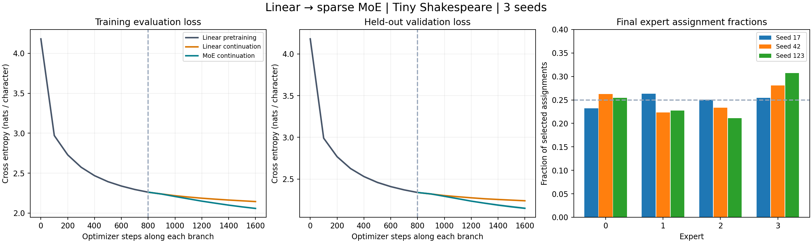
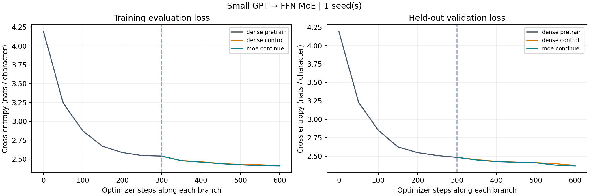
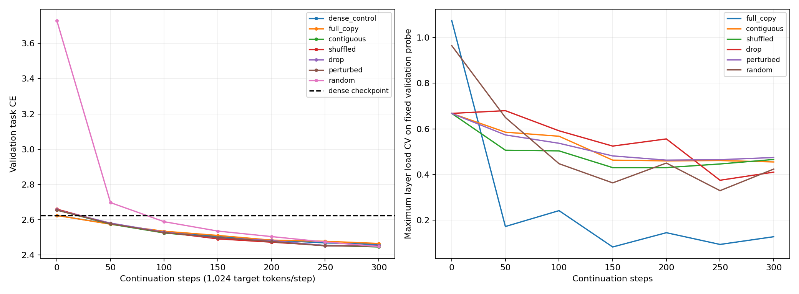

# MoE Training: experiments, results and reproduction

**Updated: 12 October 2026 · Asia/Kolkata**

This project studies how a trained small dense GPT can become a sparse Mixture-of-Experts model and continue learning. The current focus is **smaller individual experts with a larger expert count**, while controlling selected FFN width and measuring the disruption caused by conversion.

**Measured outcome:** the dense GPT trained successfully; full-size copying and narrower-expert conversion both continued training with decreasing loss. Seven continuation/initialization branches have now completed from one trained GPT checkpoint. All recovered below that checkpoint’s validation loss. These are small-scale demonstrations, not evidence of a reliably superior MoE method or frontier performance.

**Where training happened:** all measured runs in this repository executed on the local **CPU**. No direct Colab access was granted. The user has now reported a failed GPT notebook attempt on Colab; the supplied follow-up log shows dense pretraining completed and conversion failed its absolute-only logit-error check. No GPU MoE continuation result is available. The TinyStories preparation/training pipeline remains unrun. Three self-contained Colab notebooks are prepared and syntax-checked.

## Contents

- [Scope and status](#scope-and-status)
- [Environment and datasets](#environment-and-datasets)
- [Architecture and conversion](#architecture-and-conversion)
- [Experiment 1: preliminary affine model](#experiment-1-preliminary-affine-model)
- [Experiment 2: dense GPT to full-size experts](#experiment-2-dense-gpt-to-full-size-experts)
- [Experiment 3: narrower experts and constant selected width](#experiment-3-narrower-experts-and-constant-selected-width)
- [Experiment 4: seven single-seed continuation methods](#experiment-4-seven-single-seed-continuation-methods)
- [Experiment 5: clone-routing smoke checks](#experiment-5-clone-routing-smoke-checks)
- [What we learned and what remains unresolved](#what-we-learned-and-what-remains-unresolved)
- [Reproduce locally](#reproduce-locally)
- [Colab notebooks](#colab-notebooks)
- [Tests and evidence](#tests-and-evidence)
- [Project structure and study plans](#project-structure-and-study-plans)

## Scope and status

The original word “linear” was clarified to mean a **small dense GPT**. The initial literal affine experiment is preserved as a preliminary routing exercise. The GPT uses causal attention and nonlinear SwiGLU FFNs; it is neither a literal linear predictor nor a linear-attention model.

| Experiment / deliverable | Execution status | Evidence |
|---|---|---|
| Literal affine predictor → four full-copy experts, three seeds | Completed on CPU | [routing report](local-results/routing/REPORT.md) |
| Small dense GPT → four full-size experts/top-2 | Completed on CPU, seed 17 | [GPT report](local-results/gpt-cpu-pilot/REPORT.md) |
| Dense / full-copy top-1 / narrower-expert top-4 comparison | Completed on CPU, seed 17 | [Partition report](local-results/granular-cpu-pilot/REPORT.md) |
| Five narrow initialization methods plus two controls | Completed on CPU, seed 17 | [Seven-method report](local-results/narrow-methods-cpu-seed17/REPORT.md) |
| Seven clone-routing arms, initial and revised smoke runs | Completed on CPU toy tokens | [Revised smoke report](local-results/clone-cpu-smoke-v2/REPORT.md) |
| TinyStories preparation with train-only BPE | Implemented; unrun | [Preparation script](../scripts/prepare_tinystories_lab.py) |
| GPT / clone-growth / narrow-expert Colab notebooks | Prepared and syntax-checked; GPU execution pending | [Notebook section](#colab-notebooks) |
| Five-day sprint and longer study plans | Documents completed; experiments only partly implemented | [Study plans](#project-structure-and-study-plans) |
| Future 70B sparse pretraining from scratch | Planning only, outside this project’s current execution scope | [70B framework](../../MoE_Study_Materials/70B_PRETRAINING.md) |

The repository is local, with no published GitHub remote. The colleague’s numbers are motivation, not our measurements; their code or experiment sizes were not reproduced. No 20M→460M or 70B training run has occurred.

## Environment and datasets

### Measured local environment

| Item | Recorded environment |
|---|---|
| Processor | AMD Ryzen 5 5500U |
| System memory | Approximately 14 GiB |
| Python | 3.12.2 |
| PyTorch | 2.9.1+cu128 |
| Execution device | CPU; CUDA unavailable |
| PyTorch threads | 2 |
| GPT precision | FP32; no autocast |
| GPT dropout | None |
| Future GPU choice | Colab T4 / 16 GB requested; actual hardware must be recorded when run |

The CUDA build suffix does not imply that training used a GPU. Each result directory’s `environment.json` records its executed environment and source hashes. Dependencies are compatibility ranges rather than an exact lockfile.

### Tiny Shakespeare: all measured language experiments

Source: [Karpathy’s char-rnn Tiny Shakespeare corpus](https://raw.githubusercontent.com/karpathy/char-rnn/master/data/tinyshakespeare/input.txt).

- 1,115,394 characters/bytes; 65-character vocabulary derived from training text.
- Raw-text contiguous split: 892,315 training, 111,539 validation and 111,540 test characters.
- Windows are built after splitting, so no input/target crosses a split boundary.
- Windows within a split may overlap, and fixed evaluation sampling uses replacement.
- SHA-256: `86c4e6aa9db7c042ec79f339dcb96d42b0075e16b8fc2e86bf0ca57e2dc565ed`.

The affine task predicts one character per window. The GPT task predicts the next character at every position in a causal sequence. Loss is task cross-entropy in natural-log units per target character, separate from routing auxiliaries. Different contexts/objectives make cross-experiment scores unsuitable for a direct architectural ranking. Character CE must not be compared directly with a future subword-token CE.

### TinyStories: prepared larger-data stage, unrun

The [preparation script](../scripts/prepare_tinystories_lab.py) streams a bounded subset of [roneneldan/TinyStories](https://huggingface.co/datasets/roneneldan/TinyStories), records its immutable revision, and uses a fixed buffered shuffle. Defaults are 12,000 training stories and 2,400 held-out candidate stories. The official validation split is divided into our validation/test subsets after exact cross-split deduplication; final counts may be smaller.

A byte-level BPE tokenizer with a 4,096 vocabulary target is trained on training stories only. Stories are concatenated with EOS, and causal attention may cross EOS. Dataset/tokenizer hashes and token counts are saved. This is not near-duplicate decontamination or a globally uniform dataset sample. The local Tiny Shakespeare results have not established a dataset-size bottleneck; TinyStories is a broader next stage, not a proven remedy for a measured failure.

### Toy tokens: routing execution checks only

The clone smoke uses a synthetic repeating sequence with vocabulary size 13. Its short runs validate dispatch, scheduling and diagnostics. They are not LLM quality experiments.

## Architecture and conversion

### Small GPT

The measured GPT is a decoder-only causal Transformer with two pre-LayerNorm blocks, residual width 64, four attention heads, context 64, intermediate FFN width 128, learned position embeddings and tied token/output embeddings. Attention uses causal scaled-dot-product attention. Each FFN is a bias-free SwiGLU:

```text
FFN(x) = down(silu(gate(x)) * up(x))

gate.weight: [intermediate, residual_width]
up.weight:   [intermediate, residual_width]
down.weight: [residual_width, intermediate]
```

The dense GPT has **90,816 parameters**. Conversion copies attention, embeddings, positions, norms and output head; the FFNs become expert banks. Every trainable component continues updating. There is no freeze stage in the measured GPT initialization comparisons.

### Full-size copying

Each expert receives a complete trained FFN. Selected routing weights are normalized to sum to one. At initialization, identical expert functions yield the original FFN output, independent of which copies are selected, up to numerical error. The original GPT experiment uses four experts/top-2; the later compute-control experiment uses four experts/top-1.

### Narrow partition copying

Keep residual input/output width fixed. Divide the trained intermediate units into four groups. For every selected group, copy matching **gate/up rows and down columns** into a width-32 expert. Four replicas of each group produce 16 experts. Top-4 selects 128 intermediate units per token.

```python
expert.gate.weight.copy_(dense.gate.weight[indices, :])
expert.up.weight.copy_(dense.up.weight[indices, :])
expert.down.weight.copy_(dense.down.weight[:, indices])
```

The sum of one expert from each disjoint partition reconstructs the original FFN. Our normalized router averages selected expert outputs, so the narrow mixture uses output scale **4**. Uniform weights over one of each partition would reconstruct the sum. Flat top-4 can select replicas of one partition and omit another; unequal routing weights also change the sum. **Partition conversion therefore need not preserve the original logits.** We record the conversion CE jump and logit drift instead of silently treating it as exact full copying.

### Parameter and compute accounting

| Local branch | Individual expert width | Experts | Top-k | Selected FFN width | Total parameters | Active convention |
|---|---|---|---|---|---|---|
| Dense | 128 | 1 | 1 | 128 | 90,816 | 90,816 |
| Original full-copy GPT MoE | 128 | 4 | 2 | 256 | 238,784 | 140,480 |
| Later full-copy control | 128 | 4 | 1 | 128 | 238,784 | 91,328 |
| Narrow partition MoE | 32 | 16 | 4 | 128 | 240,320 | 92,864 |

The active convention counts all nonexpert parameters, including the full tied embedding table and router, plus selected expert weights. It is not a FLOP count or actual memory-access count.

For the bias-free three-matrix SwiGLU, FFN matrix MACs per token/layer are `3 × d × k × h_expert`. The later dense/full-copy/narrow comparison fixes this at **24,576**, while routing/dispatch/activation costs differ. The router’s matrix MACs are 256 for the full-copy control and 1,024 for the narrow bank. Total optimizer work and resident parameter memory also differ. Sparse activation does not remove inactive expert weights from memory.

## Experiment 1: preliminary affine model

**Question:** can a trained affine next-character predictor become a sparse routed mixture and continue learning?

A context of 16 one-hot characters produces 1,040 fixed input features. One affine map predicts 65 next-character logits. It has 67,665 parameters. Four cloned affine experts with normalized top-2 routing have 274,824 total parameters and 139,494 selected-expert-plus-router parameters per target.

| Setting | Value |
|---|---|
| Seeds | 17, 42, 123 |
| Dense pretraining | 800 steps × 256 targets = 204,800 targets/seed |
| Each continuation | Another 800 steps = 204,800 targets |
| Learning rates | 0.003 dense; 0.002 continuation |
| Evaluation | 4,096 fixed sampled windows per split; every 100 steps |
| Continuation optimizer | AdamW reset in both branches; matched sampled windows |
| Balance coefficient | 0.01 |

| Seed | Initial validation CE | Trained affine | Dense continuation | MoE continuation | Final MoE test CE |
| --- | --- | --- | --- | --- | --- |
| 17 | 4.176091 | 2.342965 | 2.239687 | 2.157658 | 2.177699 |
| 42 | 4.176660 | 2.337062 | 2.239597 | 2.145183 | 2.181228 |
| 123 | 4.190873 | 2.335082 | 2.237464 | 2.143636 | 2.169030 |

| Stage | Mean validation CE | Sample standard deviation |
| --- | --- | --- |
| Initial | 4.181208 | 0.008375 |
| Trained affine | 2.338370 | 0.004101 |
| Dense continuation | 2.238916 | 0.001258 |
| MoE continuation | 2.148826 | 0.007688 |

Standard deviations describe these three seeds; they are not confidence intervals. All seeds reduced training and validation loss before and after conversion. Maximum conversion logit error was **9.536743e-7**. Saved model/optimizer/sampler state reproduced the next update within 1e-6.

The MoE used more active work than the affine control. This is an equal-target-token demonstration, not a matched-compute efficiency claim. It is a preliminary exercise under the original interpretation, not the clarified GPT routing.

[Full report](local-results/routing/REPORT.md) · [Config](local-results/routing/config.json) · [Raw summary](local-results/routing/summary.json)



## Experiment 2: dense GPT to full-size experts

**Question:** does a real causal GPT continue learning after trained FFNs are copied into full-size experts?

Seed 17; 300 dense updates followed by 300 per continuation branch, batch 16 and context 64. Each phase contains **307,200 target characters**. Dense LR is 0.001; continuation LR is 0.0005. AdamW is reset for both branches, with betas (0.9, 0.95), weight decay 0.01, gradient clip 1.0 and balance coefficient 0.01. Evaluation uses 32 fixed sequences per split every 50 updates. Routing is four experts/top-2, normalized and dropless.

| Stage | Validation CE | Final test CE |
| --- | --- | --- |
| Initial GPT | 4.190773 | — |
| Dense GPT after 300 steps | 2.483576 | — |
| dense_control | 2.373484 | 2.391627 |
| moe_continue | 2.367056 | 2.386638 |

Maximum conversion logit error was **2.622604e-6**. All expert matrices changed and every phase’s next-update checkpoint check passed. The MoE reduced training and validation loss, satisfying the small-scale continuation objective.

Its final validation advantage over dense continuation was only about **0.0064 CE** in one seed. Top-2 doubles selected FFN width relative to dense, and the MoE has more total parameters. These results do not establish a robust quality or compute advantage. Generated character samples are saved in `generation_samples.json` as illustrations, not benchmark evaluations.

[Full report](local-results/gpt-cpu-pilot/REPORT.md) · [Config](local-results/gpt-cpu-pilot/config.json) · [Raw summary](local-results/gpt-cpu-pilot/summary.json)



## Experiment 3: narrower experts and constant selected width

**Question:** can we shrink individual experts, increase their count and recover from the conversion change while keeping selected FFN width constant?

Seed 17; 150 dense updates (**153,600 targets**), then 150 updates per branch (**153,600 additional targets**). Same two-layer GPT, LR 0.001→0.0005, batch 16, context 64 and optimizer settings as Experiment 2. Controls are dense continuation and four width-128 full-copy experts/top-1. The narrow branch uses 16 width-32 experts/top-4, contiguous unit partitions and scale 4.

Dense validation CE trained from **4.190773 to 2.624921**.

| Arm | Conversion validation CE | Final validation CE | Final test CE | Max conversion logit drift |
| --- | --- | --- | --- | --- |
| dense_control | 2.624921 | 2.505817 | 2.509203 | 0 |
| full_copy | 2.624921 | 2.511586 | 2.511266 | 7.15256e-07 |
| granular | 2.655241 | 2.498899 | 2.504842 | 2.93491 |

The narrow branch’s conversion CE increased by **0.030320**, then decreased to **2.498899**, recovering below the original dense checkpoint. Its logit drift is expected because flat routing does not guarantee complete partition coverage. Full copying remained function-preserving within numerical tolerance. All expert matrices changed and checkpoint checks passed.

The selected width and FFN matrix MACs are matched, but whole runtime and router costs are not. This checkpoint is the common starting point for Experiment 4. Its shorter pretraining budget explains why it must not be treated as the same trained baseline as Experiment 2.

[Full report](local-results/granular-cpu-pilot/REPORT.md) · [Specification](docs/NARROW_EXPERT_EXPERIMENT.md) · [Raw summary](local-results/granular-cpu-pilot/summary.json)

## Experiment 4: seven single-seed continuation methods

**Question:** how does narrow-expert initialization change conversion disruption and recovery?

Reused Experiment 3’s **same trained dense checkpoint**, rather than retraining it. Seed remains 17. Every branch receives **300 continuation updates / 307,200 additional targets**, with identical sampled batches, reset AdamW and the same hyperparameters. The five narrow methods share 16 width-32 experts, top-4, scale 4 and **identical initial router matrices**. Hidden-state differences can still cause different routings at conversion.

| Method | Expert initialization |
|---|---|
| `dense_control` | Continue the original dense GPT |
| `full_copy` | Copy the complete trained FFN into four experts/top-1 |
| `contiguous` | Four adjacent disjoint unit groups, four replicas each |
| `shuffled` | Fixed permutation before disjoint partitioning, four replicas each |
| `drop` | Independently retain a quarter of trained units per expert; overlaps across experts allowed |
| `perturbed` | Contiguous copies plus independent Gaussian noise at 1% of each copied matrix’s RMS |
| `random` | Newly initialized narrow experts; trained attention, embeddings and norms retained |

Our `drop` definition is explicit and does not claim to reproduce the colleague’s unavailable implementation. Random experts are not a randomly initialized entire GPT.

| Method | Conversion CE | CE jump | Final validation CE | Final test CE |
| --- | --- | --- | --- | --- |
| dense_control | 2.624921 | +0.000000 | 2.460981 | 2.468332 |
| full_copy | 2.624921 | +0.000000 | 2.466103 | 2.478232 |
| contiguous | 2.655241 | +0.030320 | 2.446182 | 2.466355 |
| shuffled | 2.660617 | +0.035696 | 2.451317 | 2.463225 |
| drop | 2.656356 | +0.031435 | 2.456125 | 2.463281 |
| perturbed | 2.655223 | +0.030302 | 2.450853 | 2.465865 |
| random | 3.729246 | +1.104324 | 2.448603 | 2.457162 |

All branches reduced loss and recovered below the dense checkpoint’s 2.624921 validation CE. Test scores were evaluated after the predeclared arms finished and were not used to select methods.

| Method | Total parameters | Active convention | Continuation seconds | Expert matrices changed | Next-update error |
| --- | --- | --- | --- | --- | --- |
| dense_control | 90,816 | 90,816 | 5.07 | N/A | 0 |
| full_copy | 238,784 | 91,328 | 7.39 | True | 0 |
| contiguous | 240,320 | 92,864 | 13.33 | True | 0 |
| shuffled | 240,320 | 92,864 | 12.85 | True | 0 |
| drop | 240,320 | 92,864 | 13.71 | True | 0 |
| perturbed | 240,320 | 92,864 | 14.39 | True | 0 |
| random | 240,320 | 92,864 | 13.29 | True | 0 |

Times include evaluation and exclude checkpoint saving/reload verification. The active convention is defined above. All experts had nonzero allocations on the final fixed validation probe in each MoE layer. This is not proof of starvation-free training over longer windows.

**Observed learning:** copied narrow experts limited the initial CE disruption to about 0.03, versus **1.104324** for random experts. At update 50, contiguous copying had validation CE **2.575785** versus random **2.697639**: transfer helped early recovery. Random experts caught up substantially by update 300, with the rest of the pretrained GPT intact. The 1% perturbation did not improve final CE over contiguous copying in this seed. Small final differences and one dataset/seed do not establish a method ranking.

**Observed cost:** narrow branches took roughly 13–14 seconds versus dense 5 seconds and full-copy 7 seconds. Constant selected FFN width did not deliver constant runtime in our Python sparse-dispatch CPU implementation. This is not an optimized GPU benchmark.

[Full report](local-results/narrow-methods-cpu-seed17/REPORT.md) · [Method guide](docs/SINGLE_SEED_METHODS.md) · [Raw summary](local-results/narrow-methods-cpu-seed17/summary.json)



## Experiment 5: clone-routing smoke checks

**Question:** do the clone-growth routing policies and diagnostics execute correctly? This was an execution check, not a meaningful language-model comparison.

The toy GPT has one layer, width 16, intermediate width 32, context 8, vocabulary 13 and batch 2. Seed 17; three dense updates, three four-expert parent updates, then growth to **12 experts/top-2** with ten continuation updates per arm. Each update supervises only 16 toy tokens. Grown models have **20,080 total / 4,720 active-convention parameters**.

| Arm | Policy varied |
|---|---|
| `hard` | Immediate hard top-k, no balancing auxiliary |
| `warmup` | Stochastic Gumbel top-k for four steps, then hard routing |
| `anneal` | Exploration probability decays to zero over eight steps |
| `adaptive` | Switch after minimum warmup, sufficient cumulative routings and repeated hard-calibration coverage checks |
| `family` | Select distinct parent families, then children; sampled warmup followed by hard routing |
| `bias` | Hard routing with detached selection-bias load balancing |
| `aux` | Hard routing with balancing auxiliary coefficient 0.01 |

All validation/calibration probes use hard routing. Adaptive readiness is an experimental coverage/exposure heuristic; output-distance diagnostics are not a validated switch threshold.

The revised smoke’s base validation CE was **2.582598 → 2.568787 dense → 2.550211 parent MoE**.

| Arm | Growth validation CE | Final toy validation CE | Switch step | Hard steps after switch | Final rolling hard-probe zero count |
| --- | --- | --- | --- | --- | --- |
| hard | 2.550177 | 2.525528 | 0 | 10 | [0] |
| warmup | 2.550177 | 2.525671 | 4 | 6 | [0] |
| anneal | 2.550177 | 2.525682 | 8 | 2 | [1] |
| adaptive | 2.550177 | 2.525685 | 4 | 6 | [0] |
| family | 2.550211 | 2.525676 | 4 | 6 | [1] |
| bias | 2.550177 | 2.525574 | 0 | 10 | [0] |
| aux | 2.550177 | 2.525575 | 0 | 10 | [0] |

All seven arms completed. The displayed zero count aggregates recent hard calibration probes; the final individual probe’s fractions can differ. All arms had zero unassigned experts over the final configured training window. A zero count on a probe or short window does not establish permanent death or guaranteed future survival.

Two result directories are preserved:

- [`clone-cpu-smoke`](local-results/clone-cpu-smoke/summary.json): original execution check.
- [`clone-cpu-smoke-v2`](local-results/clone-cpu-smoke-v2/REPORT.md): separate rerun after limiting sibling output-distance diagnostics to at most eight sampled siblings per family. Use this report for the revised implementation’s smoke evidence.

Neither run answers how long a probabilistic warmup should last for a large LLM. Stochastic checkpoint next-update equivalence remains unverified for this routing lab, unlike the deterministic language experiments. No GPU OOM, large-scale routing collapse or capacity limit has been demonstrated.

## What we learned and what remains unresolved

1. **Continuation works at this scale.** Both full copies and narrow parameter subsets continued training and lowered task CE.
2. **Narrowing and sparsity are independent choices.** Expert count, expert width and top-k control different aspects of storage and selected computation.
3. **Full copying and partition copying preserve different things.** Full copies preserve the expert function under normalized mixing. Partitions preserve pieces whose complete sum reconstructs it; sparse mixtures need not reproduce that sum.
4. **Transfer mostly protected early behavior in this run.** Random expert replacement caused a large loss jump, then recovered with the rest of the trained GPT retained.
5. **Weight perturbation is not a guaranteed improvement.** It breaks clone symmetry, but neither utilization nor quality is guaranteed by parameter differences alone.
6. **More narrow experts add overhead.** Router cost, dispatch count, memory residency and optimizer work must be measured separately from selected FFN width.
7. **Expert utilization needs a time window.** One batch/probe with zero routings differs from persistent starvation. Expert parameter changes also include weight-decay effects and do not prove semantic specialization.

Identical expert weights do not imply identical router logits unless router rows/biases are also identical. Stochastic sparse selection is different from executing all experts in a dense soft mixture, and it does not guarantee that every expert receives a token. Family-aware selection can protect parent-mixture structure, but does not guarantee child utilization. No universal warmup step count or weight-distance threshold has been established here.

The current limitations are single-seed GPT evidence, a small character corpus, short contexts, FP32 and Python sparse dispatch. Persistent collapse, long-run specialization, optimizer-state migration, large datasets, mixed precision, optimized kernels and distributed expert parallelism remain unresolved. The multi-seed affine result cannot substitute for multi-seed GPT confirmation.

The next controlled study can fix initialization and vary routing/exploration or replica count. Larger data, more seeds and GPU runs can follow when their additional evidence is needed. This README does not schedule or start them.

## Reproduce locally

Run commands from the repository root. Always choose a **new output directory**; trainers refuse to overwrite evidence. No new training is needed to read the stored reports.

### Setup

```bash
python3 -m pip install -r requirements.txt
python3 scripts/download_data.py
python3 -m unittest discover -s tests -v
```

### Affine and original GPT experiments

```bash
python3 -m src.train --device cpu --output results/affine-reproduction
python3 scripts/report.py --results results/affine-reproduction

python3 -m src.train_gpt --config configs/gpt_cpu.json --device cpu --output results/gpt-reproduction
python3 scripts/report_gpt.py --results results/gpt-reproduction
```

### Narrow-expert baseline

```bash
python3 -m src.granular_experiment --config configs/granular_cpu.json --data data/tinyshakespeare.txt --device cpu --output results/granular-reproduction
```

This creates its own report and checkpoints. To reproduce the seven methods from this newly generated dense checkpoint, write a config that points to it:

```bash
python3 - <<'CODE'
import json
from pathlib import Path
cfg = json.loads(Path('configs/narrow_methods_cpu.json').read_text())
cfg['checkpoint'] = 'checkpoints/granular-reproduction/17/dense_pretrain.pt'
cfg['dense_evidence'] = 'results/granular-reproduction'
Path('work').mkdir(exist_ok=True)
Path('work/narrow-reproduction.json').write_text(json.dumps(cfg, indent=2))
CODE
python3 -m src.compare_narrow_methods --config work/narrow-reproduction.json --output results/methods-reproduction
python3 scripts/report_narrow_methods.py --results results/methods-reproduction
```

If the original local checkpoint is already present, the shorter command is:

```bash
python3 -m src.compare_narrow_methods --output results/methods-new-run
python3 scripts/report_narrow_methods.py --results results/methods-new-run
```

Git does not include the corpus or checkpoints. A fresh checkout must download the corpus and generate the prerequisite checkpoint; pointing a config at a nonexistent historical checkpoint will not work.

### Recreate the toy clone smoke

```bash
python3 -m pip install -r requirements-lab.txt
python3 - <<'CODE'
from pathlib import Path
import numpy as np
Path('work').mkdir(exist_ok=True)
tokens = np.tile(np.arange(13, dtype=np.int32), 400)
np.savez('work/clone-smoke.npz', train=tokens, validation=tokens, test=tokens, vocab_size=13)
CODE
python3 -m src.clone_sweep --config results/clone-cpu-smoke-v2/config.json --data work/clone-smoke.npz --device cpu --output results/clone-smoke-new --arms hard warmup anneal adaptive family bias aux --max-runs 7
python3 scripts/report_clones.py --results results/clone-smoke-new
```

This constructs a toy execution fixture, not an independent train/validation/test corpus. The repeating toy phase/length may differ from the original smoke fixture; no bitwise reproduction of the historical toy metrics is claimed by this command.

## Colab notebooks

Upload a notebook to Colab, select a GPU runtime, and run its cells in order. Each embeds a source snapshot, so a GitHub publication is unnecessary. **All are prepared; none has been GPU-executed.**

| Notebook | Intended experiment | Default configuration |
|---|---|---|
| [GPT_to_MoE.ipynb](notebooks/GPT_to_MoE.ipynb) | Full-size FFN copying on Tiny Shakespeare | Four layers, width 128, context 128, four experts/top-2, three seeds |
| [Narrow_Experts_T4.ipynb](notebooks/Narrow_Experts_T4.ipynb) | Dense / full-copy / narrow partition on TinyStories | Four layers, width 192, FFN 384, narrow width 96, 16 experts/top-4, seed 17 |
| [Clone_Collapse_T4.ipynb](notebooks/Clone_Collapse_T4.ipynb) | Clone growth and routing-policy study on TinyStories | Four layers, width 192, FFN 384, initial bounded routing comparison |

The narrow notebook uses batch 4/context 128, 500 dense steps plus 500 per continuation branch: **256,000 target tokens/phase**. It has plots, parameter/memory reporting, checkpoint checks and an evidence download. An opt-in finer comparison uses eight partitions, width 48, 32 experts/top-8; selected width and stored FFN weights remain constant while router/dispatch costs grow. This notebook preserves the original three-way source snapshot; it does not include the later seven-initialization sweep.

The clone lab has an opt-in growth ladder up to 972 full-size experts and bounded run/time controls. A memory-estimate skip is not an observed CUDA OOM; a timeout is not routing collapse. Planned GPU size limits are not measured results. Preserve the downloaded evidence archive before disconnecting.

CPU execution is enough for the basic small-scale routing. Colab is useful for faster larger-data experiments, capacity exploration and actual GPU memory/throughput measurements; it is not required merely to validate continued learning.

## Tests and evidence

**Latest completed repository check: 26 unit tests passed.** Test coverage grew as modules were added; historical reports mention the smaller suite available at their execution time.

| Test file | Properties checked |
|---|---|
| [test_models.py](../tests/test_models.py) | Affine conversion, selected-k validity, sparse/reference outputs, router gradient behavior |
| [test_gpt.py](../tests/test_gpt.py) | GPT causality, full-copy logits, sparse/reference gradients, parameter accounting |
| [test_granular.py](../tests/test_granular.py) | Partition reconstruction, coordinated slices, selected-row dispatch, finite gradients, shape/count validation |
| [test_narrow_methods.py](../tests/test_narrow_methods.py) | Equal variant sizes/common routers, shuffled reconstruction, subset copying, perturbation symmetry/reproducibility |
| [test_routing_lab.py](../tests/test_routing_lab.py) | Family conversion control, distinct sampled selections/probe RNG behavior, bias balancing behavior |

Language runs also perform finite objective/gradient checks and verify an identical next update after restoring model, AdamW and sampler state. Those are execution checks, not separate unit tests. Deterministic language checkpoint errors were below 1e-6; the latest seven-method run recorded zero. Stochastic-routing restart equivalence remains pending.

Result directories contain some or all of:

- `config.json`: frozen run settings.
- `data_manifest.json`: source/split/hash information, where applicable.
- `environment.json`: executed versions, device and source hashes; latest sweep also records the dense checkpoint hash.
- `metrics.jsonl`: unsmoothed phase/step records, task CE, auxiliary objective, gradients and routing statistics.
- `summary.json`: final metrics, parameter counts, conversion changes and recovery checks.
- `REPORT.md`, PNG/SVG figures: human-readable views derived from measured records.

The GPT also saves illustrative generated samples. Clone runs have `base_summary.json` for dense/parent stages. Local `checkpoints/` includes model and optimizer states but is ignored by Git. Source hashes identify the executed code even if a historical Git commit was absent or the code later grew.

A favorable experiment does not overwrite an unfavorable one. The first/revised clone smoke directories remain separate. No test score was used to tune the reported seven-method comparison.

## Project structure and study plans

```text
MoE_Training/
├── README.md                    # Canonical experiment documentation
├── readme.md                    # Compatibility pointer
├── AGENTS.md / Agents.md        # Working instructions
├── Progress.md                  # Chronological work/evidence log
├── src/
│   ├── models.py / train.py     # Preliminary affine experiment
│   ├── gpt.py / train_gpt.py    # Dense GPT and full-copy MoE
│   ├── granular.py             # Narrow coordinated partition copying
│   ├── granular_experiment.py  # Three-way continuation experiment
│   ├── narrow_methods.py       # Five narrow initialization variants
│   ├── compare_narrow_methods.py
│   └── routing_lab.py / clone_sweep.py
├── configs/                    # Local/GPU experiment settings
├── tests/                      # Mathematical and execution invariants
├── scripts/                    # Dataset preparation and report builders
├── notebooks/                  # Self-contained Colab snapshots
├── results/                    # Preserved measured evidence
├── docs/                       # Explanations, sources and study plans
├── data/                       # Local corpora/tokenizers; ignored by Git
├── checkpoints/                # Local checkpoints; ignored by Git
└── work/                       # Scratch configurations/logs
```

Further reading:

- [GPT experiment explanation](docs/EXPERIMENT_EXPLAINED.md)
- [Narrow-expert specification](docs/NARROW_EXPERT_EXPERIMENT.md)
- [Single-seed method interpretation](docs/SINGLE_SEED_METHODS.md)
- [Continuation and routing strategies](docs/CONTINUATION_STRATEGIES.md)
- [Primary-source catalog](../../MoE_Study_Materials/SOURCES.md)
- [Five-day architecture sprint](../../MoE_Study_Materials/ROADMAP_5_DAYS.md)
- [14-day crash course and 12-week engineering/interview path](../../MoE_Study_Materials/LEARNING_PATHS.md)
- [Future 70B pretraining framework](../../MoE_Study_Materials/70B_PRETRAINING.md)

The roadmap documents were created/finalized with Astra. Their original “parked,” “no Transformer run,” and tentative-hardware wording is historical and superseded by the measured GPT runs, T4 preference and local continuation documented here. They are study plans, not completed experiments or scheduled automation. Roadmap changes remain a separate task.

The longer study covers MoE architecture and training dynamics from OLMo/OLMoE, Kimi, Qwen and DeepSeek. Modern architecture claims belong to the dated primary-source catalog; this README reports our own measured experiments. The eventual ambition is **70B sparse pretraining from scratch**, outside the current run scope. Whether 70B refers to total or active parameters is not finalized; the plan provisionally assumes total. Matching an open model’s results requires a specified recipe, data, compute and evaluation target, not just copying architecture names.


## Reported Colab failure and diagnostics — 12 October 2026

The user reported `GPT_to_MoE.ipynb` exiting with status 1 at the training subprocess. The provided `CalledProcessError` is only the parent wrapper, and the child traceback was unavailable. The root cause remains unknown; CUDA OOM, numeric assertions or runtime configuration must not be assumed without evidence.

The notebook now streams combined stdout/stderr, saves them to `work/logs/` and includes the last child output in a raised error. Run directories use microsecond timestamps to avoid accidental collisions. The archive cell can be run after failure to preserve logs and partial checkpoints. Two new targeted tests verify stderr retention, failure propagation and refusal to overwrite logs; the full repository suite now has 19 tests.

For an already initialized Colab session, paste [colab_gpt_training_cell.py](../scripts/colab_gpt_training_cell.py) into the failed training cell. It is self-contained and needs no new setup files. It starts a fresh diagnostic run with the original model/config and retains previous evidence. This diagnoses the failure; it is not a claimed fix for its still-unknown cause. No training settings or numerical acceptance tolerances were relaxed.


### Follow-up: conversion assertion identified

The user’s [reported Colab log](local-results/gpt-colab-user-report/REPORT.md) shows seed-17 dense training reached validation CE **4.216622→1.889444**, then failed at conversion: max absolute logit difference **2.2411346e-5**, above the old `1e-5` cutoff. No dense-control/MoE continuation ran. These are user-reported CUDA outputs, separate from locally executed results; GPU type and runtime archive are unavailable.

Full-copy expert weights are now checked for exact equality. The logit comparison uses per-entry `abs(error) <= 1e-5 + 1e-5*abs(reference)`, plus finite checks and probe CE change at most `1e-5`. Absolute/RMS errors, tolerance violations and probability/CE changes are written to `conversion-<seed>.json` before accepting or rejecting conversion. This adds a relative component to the prior absolute-only criterion; historical results retain their original checks. [PyTorch numerical accuracy documentation](https://docs.pytorch.org/docs/main/notes/numerical_accuracy.html) explains why mathematically equivalent batched/sliced computations need not be bitwise equal. Floating-point differences are a hypothesis for the reported error, not a proven GPU diagnosis from the maximum alone.

Use [colab_gpt_recover_cell.py](../scripts/colab_gpt_recover_cell.py) in the original initialized runtime to patch the trainer and recover seed 17 from the completed dense checkpoint. It skips pretraining, copies old evidence/checkpoints into a new continuation run with provenance, and leaves the original files intact. It automatically discovers surviving completed dense runs. If a runtime restart removed them, it bootstraps the source/data and starts a fresh seed-17 run; no old timestamp must be edited. Fresh full runs use the updated GPT notebook. GPU acceptance remains unverified until that recovery executes.

Two numerical-check tests verify scale-aware roundoff acceptance and rejection of material/near-zero/nonfinite changes. A local two-step CPU resume smoke verified checkpoint loading, inherited dense metrics, conversion diagnostics and both branches’ next-update recovery. Its final MoE validation-drop acceptance failed at the deliberately tiny two-step budget; this is retained in `work/resume-check.log` and is not a new favorable language experiment. No GPU training has been performed by the local agent.


### Restart-safe recovery

After the user restarted Colab, the hard-coded prior run directory was absent. The recovery cell now embeds the full required source/data-preparation snapshot, discovers any completed seed-17 GPT run with metrics and a surviving dense checkpoint, and resumes it. If no checkpoint remains, it trains seed 17 from scratch with the corrected conversion check. It reports which path it takes, retains logs in new directories and downloads an evidence archive after success. A missing directory alone does not establish whether every runtime file was cleared.

Two additional tests cover empty/restarted runtimes, missing checkpoints and valid-versus-partial run discovery. GPU execution still needs user confirmation.


### T4 follow-up: independent FP64 conversion reference

The next [user-reported recovery diagnostic](local-results/gpt-colab-user-report-fp32/REPORT.md) identified **Tesla T4 / PyTorch 2.11.0+cu130**. Dense checkpoint restoration worked, but six logits violated the FP32 per-entry test. Max logit error was **3.3378601e-5**, RMS **1.2258761e-6**, maximum probability error **3.5166740e-6**, and CE change **0**. MoE continuation still did not run.

The validation now independently evaluates the dense/copied models on eight evenly spaced probe sequences on **CPU in FP64**, including router arithmetic. Require per-entry atol=rtol=1e-10 and CE change ≤1e-10. Ordinary FP32 training arithmetic is unchanged. The old FP32 per-logit result stays visible. If it fails, continuation can proceed only when the FP64 check passes AND FP32 errors satisfy all explicit limits: max absolute logits ≤1e-4, RMS logits ≤1e-5, max probability difference ≤1e-5 and absolute CE difference ≤1e-5, with finite outputs. This is a new documented acceptance path, not a claim that the old test passed. Exact expert-copy checks remain mandatory.

Local verification on the saved trained GPT gave FP64 maximum logit difference **4.4408921e-15** and zero CE change. Three additional tests cover FP64 arithmetic, corrupted models and the fallback's behavioral safeguards; the full 26-test suite passed. This local check is not verification of the user's GPU checkpoint. The updated recovery cell reuses a surviving checkpoint and requires actual FP64/bounded-FP32 checks before continuing. Previous failed result records remain unchanged; a GPU continuation result is still pending.
