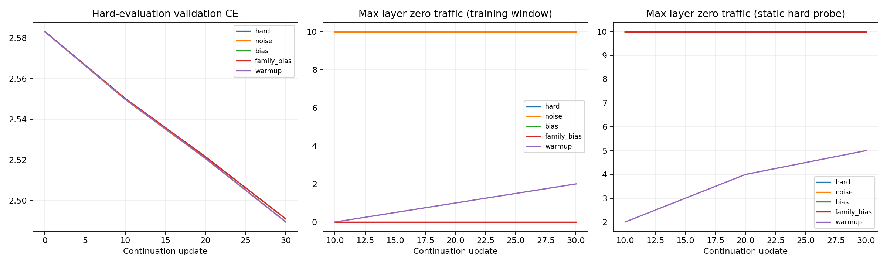
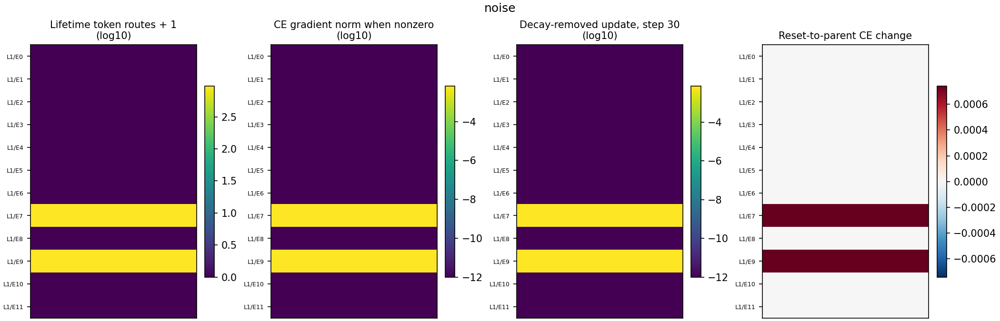
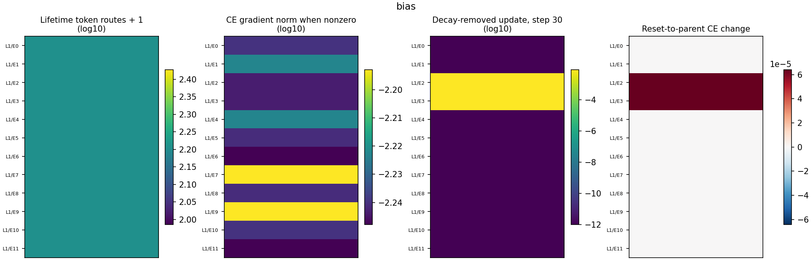
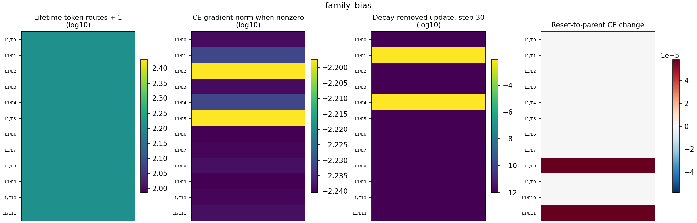
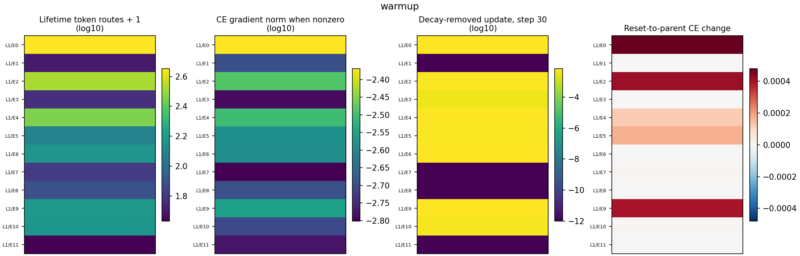

# Hard-routing repair and expert-learning measurements

**CPU synthetic execution smoke; not language-training evidence.**

| Arm | Start / final validation CE | Lifetime zero experts | Final window zero experts | Static probe zero experts | Zero CE-gradient experts | No Adam state | Positive reset deltas (>1e-6) |
|---|---|---|---|---|---|---|---|
| hard | 2.583147 / 2.489551 | 10 | 10 | 10 | 10 | 10 | 2 |
| noise | 2.583147 / 2.489551 | 10 | 10 | 10 | 10 | 10 | 2 |
| bias | 2.583147 / 2.491026 | 0 | 0 | 10 | 0 | 0 | 2 |
| family_bias | 2.583147 / 2.491050 | 0 | 0 | 10 | 0 | 0 | 2 |
| warmup | 2.583147 / 2.489540 | 0 | 2 | 5 | 0 | 0 | 7 |

## Interpretation

Token traffic is exposure, not proof of learning. CE gradients are measured before clipping and contain no auxiliary-loss term in this comparison. AdamW parameter drift includes decay; sampled update norms subtract the decay-only prediction (including the grad=None skip rule). Those updates include current and retained Adam moments, not solely this step’s gradient.

Output diversity compares sibling functions on the same fixed parent-hidden inputs across arms. Diversity alone does not prove useful specialization. Reset ablation measures held-out CE after replacing one expert’s current weights with its original parent weights while retaining router weights/bias. Positive deltas suggest those learned weights help this specific probe/current context; negative deltas favor resetting. Subsequent hidden states and routes may change as part of that causal effect.

The positive-ablation threshold 1e-6 is a numerical display convention, not statistical significance. The small fixed ablation probe cannot establish generalization per expert. State/coverage and task loss must be read together. Training-window coverage under continually updated selection biases can coexist with starvation on a static hard probe; the two columns deliberately remain separate.

Full per-layer/per-expert telemetry and optimizer counters are in summary.json and metrics.jsonl. Checkpoints retain weights, moments, biases and RNG/counter state. No exact stochastic-resume equivalence claim is made.

## hard expert telemetry

## noise expert telemetry

## bias expert telemetry

## family_bias expert telemetry

## warmup expert telemetry

